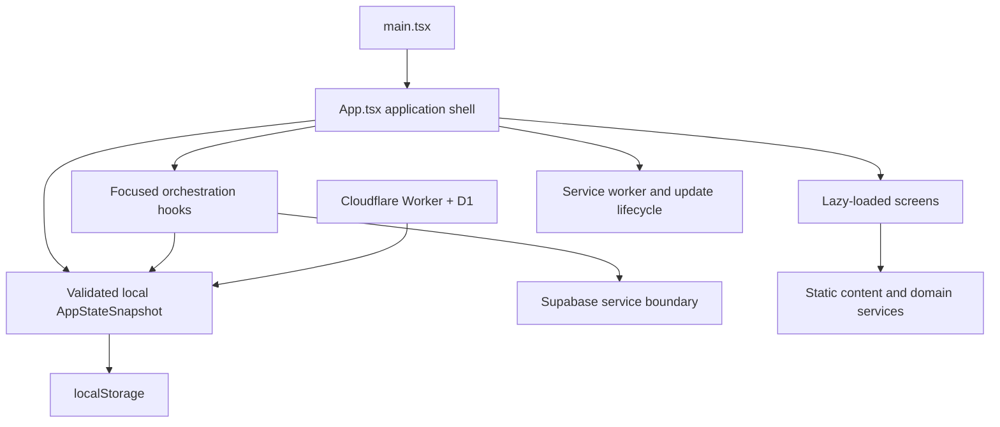

# Application architecture

## Isolated prayer seconds clock — 2026-10-20, local only

Owner-approved local restoration repair: Home's geometry hold recognizes focused prayer buttons, not a focused horizontal browsing region. WebKit can leave that native region focused after a pointer close; handlePrayerOpen reconciles the current scroll immediately when closing, while real button focus retains its hold. Blur to non-prayer controls releases it. The 96px/8px thresholds, native focus/scroll ownership, date/record semantics and existing motion remain unchanged. No deferred callback, new timer, synthetic scrolling or focus stealing.

buildPrayerCardModels adds a transient countdownInterval containing the previous/next absolute adhan instants. PrayerCard enables usePrayerCountdown only for the next summary; one second-aligned timeout and IntersectionObserver pause hidden/offscreen work, resynchronize from Date.now and clean up at expiry/unmount. Both PrayerCountdown presentations share the card's clock. Home's minute-based useNow and all calculation/record/reminder owners remain unchanged. No persisted fields, network service, dependency or screen-wide second clock. See MOTION_SYSTEM.md for the owner's positive animation policy and the reduced-motion alternative.

## Focused Progress dashboard — 2026-10-20, local implementation

ProgressScreen composes a shared Period/calendar toolbar, four independent default overview metrics, one selected timeline, optional comparisons, a searchable/sortable/paged exact-record table and the existing detailed insights/reflection. Custom dates are validated drafts applied atomically; input dates are explicitly Gregorian and display uses the visit-local chosen Gregorian/Hijri calendar. Day/Week/Month/Year URLs remain supported. Custom ranges, calendar overrides and metric/order choices are visit-local; no stored schema, backup or sync changes.

`progressDashboard` builds sparse normalized daily facts once per input revision/devotional day. It reuses prayer merge/count rules, deduplicates routine completions and valid Quran pages, and never applies a current Quran plan to unknown historical targets. Explicit historical goal/completion records are preserved. Prayer uses civil dates, routines/Quran use the configured devotional boundary. Current Day shows each domain's actual day; other ranges are clipped independently to elapsed dates. Overview includes current records; trends and equal-length period comparisons use complete days only. Unknown denominators stay null, including chart gaps and out-of-window table cells. Page counts use a zero-based count scale; rates keep 0–100%. Custom plots use at most 24 labelled bins; annual presets use actual calendar months.

Exports include all independent metrics, exact scoped daily facts and relevant source records with explicit windows/definitions; table filters/pagination never narrow the file. Detail tables mount only on request. Existing per-prayer/routine/item/Friday/reflection views and complete exports remain in optional detailed context; Custom has selected-range prayer/item/Friday context. Missing records are not interpreted as missed worship.

Owner's image correction supersedes the earlier opaque inner-title repair below: supported Glass Progress retains transparent background/color at rest and scroll. Only stationary 32px/135% frost activates at the existing thresholds, independently for outer records and inner overflowing controls. Parent frost cannot mask its own descendants, so a second filter is used only for that separate scrolling boundary. No dark tint/sheen/shadow is added to Progress. Existing solid/accessibility/unsupported-filter protection and keyboard clearance remain.

## Local reliability and bounded performance reuse — 2026-10-20

The integration repair retains pinned Noto Arabic, Latin, extended-Latin/transliteration and symbol files with exact Unicode ranges/weights; the unused mathematical supplement is no longer shipped or precached. Amiri Quran, IBM Plex and QCF remain unchanged. A tested post-order Vite plugin compacts only `.vite/manifest.json` whitespace, preserving entries/imports/hashes and budget traversal. No ceiling or reviewed source bytes change.

Startup owns one createAppStateReader, shared between initial appearance and App's lazy mount. It reuses normalized data only while exact primary/legacy storage bytes and the devotional day agree; changed storage, corrupt/denied reads and rollover retain existing normalization/fallback behavior. Ordinary loadAppState calls stay uncached.

App separates stable snapshot fields from partial counts/Masbaha state. Its mount-owned createAppStateWriter retains one normalized serialized base, rebuilding it on any other input identity/shape or day change. Counter fields are normalized on every write; the existing complete single-key localStorage write remains synchronous. Imports, remote merges and ordinary saveAppState retain full normalization. This optimization requires immutable application snapshots and creates no new persisted format or global history cache.

Preference recovery returns success only after the replacement write commits. Read/parse/write failure never removes the saved snapshot; the independent error boundary announces failure and retains retry controls. Its bilingual failure copy stays inline under the existing crash-recovery dependency exception.

Collection sharing owns one exact-text/canonical-identity glyph preparation map per generation, shared by compatibility checking and rendering. Cancelled compatibility checks stop before fonts, after fonts/glyphs and before layout. Existing sequential generation, complete text, URL cleanup and shared resource loads remain. Home/Progress memoize day-grouped path inputs per record/policy revision; each garden calculation reuses each day's verdict only within that calculation. Calendar boundaries, historical policies and missing observations are unchanged.

## Independent Progress controls and cancelled exports — 2026-10-20, local only

The shared Progress title observes its nearest controls viewport, independently of outer records elevation. During internal overflow scrolling it uses the existing opaque on-media ground in Glass, without another filter; at internal rest it remains transparent even if the records are scrolled. This narrow exception supersedes the always-transparent inner Progress header policy. Existing 8px/2px hysteresis and the 60% actual-viewport control cap remain. Keyboard focus recovery also clears controls beneath the inner title, allowing only the gap that fits the available height. Pointer interactions retain their existing scroll behavior.

Collection image generation checks cancellation before font preparation, after fonts and after asynchronous glyph preparation, before allocating the layout canvas. Shared font/page loads may finish for other consumers; discarded generations skip subsequent layout/render work. Existing progressive-page URL ownership and cleanup remain authoritative. No content, persistence, cache or dependency changes.

## Progress rendering and header fallback — 2026-10-20

Progress retains stable selected-date and empty optional-record identities across presentation-only header elevation renders. Record changes, calendar/period navigation and the existing clock invalidate derived history; the devotional-day boundary is unchanged. Progress controls start with an opaque theme background, overridden by supported Glass inside its existing feature query. A selected Glass preference without frost must not expose moving records beneath filters. No persistence, calculation or shell change.

## Complete sharing and common sizes — 2026-10-19, local only

`shareLayout` continues oversized quotations and selected additions across measured, numbered fragments at existing reading sizes. Each part repeats its heading and selected citation; original items stay intact for Text/ZIP, with duplicate identities removed from selected-card archive text. Benefits supplies the entire section independently of its screen batch, explicit bilingual payloads, no repetition metadata and all-card scope by default. Short individual evidence uses centered Square cards.

`shareContinuation` finds locale-aware exact sentence offsets. Collection continuations end at the last complete sentence that fits and move a following sentence to a fresh card first. An individually oversized sentence prefers existing clause/pause punctuation; unpunctuated text retains a word-boundary recovery with explicit continuation cues. No punctuation is inserted into reviewed text. Both image renderers label previous/next continuation; ayah translation/meaning rows keep fitting sentences together. Quran drawing reserves 8px extra inline ink clearance for QCF overhang.

`ShareFormatSelect` owns the common Story/Square/Portrait/Tall choices, dimensions and two localized destination tags in both image studios. Ayah layouts consume `SHARE_DIMENSIONS`, preserving complete text, QCF drawing and cancellation. General Quran drawing also resolves existing Benefits/Home/Wird excerpt identities; glyph-to-Unicode offsets preserve exact semantic slices across continuations. Existing readable font recovery and long-surah Mushaf reminders remain.

Home's lazy studio captures and holds the displayed source until close. `reminderSharing` supplies missing prophetic attribution as presentation text without editing reviewed quotations, excluding Quran, Companion reports and reported actions. Reading and sharing use the same attribution helper. Persistence, R2 delivery and prayer behavior are unchanged. No publication is authorized.

## Home frost/motion and Android handoff — 2026-10-19

The owner supersedes the 88% scrolled Home ground and stacked header tint with one translucent 60% on-media material and the existing stationary chrome frost. The existing registered CSS expansion value now uses the shared 220ms standard duration without a contraction delay; footer/countdown fades finish with geometry. No scroll hook, prayer, persistence or remote boundary changes. The [Android handoff](ANDROID_DEVELOPER_HANDOFF.md) maps the existing packaged host/adapters and identifies persistent app-private download files as follow-up: current native playback still consumes WebView Cache Storage, while native document export is a separate service.

## Supplied-card attribution and collection citation follow-up — 2026-10-18

Supplied routine cards append an export-only website footer through `share/attributedCard.ts`. The original image remains complete; prepared files feed Share, Save and studio previews, while Copy encodes the same layout as PNG. Decode/encoding failures retain explicit recovery and never export unbranded originals. `contentReview.ts` applies precise bilingual citation metadata to 165 verified original identities from the dated source audit; 20 Home alternatives are excluded. Counts, wording and stored identities are unchanged.

## Actionable Progress insights — 2026-10-18, local only

Historical Progress derives prayer comparisons and three daily-routine patterns from existing normalized records. `progressInsights.ts` resolves the selected calendar range, excludes the current unfinished progress day, deduplicates collection/day pairs and groups daily, seven-day or calendar-month trend points. No stored schema, tracking-start inference, synchronization or devotional text changes. Prayer analysis retains civil dates, while routine analysis uses the configured devotional-day rollover. Historical denominators include every complete day in the period, including days without records; this supersedes earlier through-today denominators for Progress only.

`RecordingInsights` handles ties, no records and fewer than three complete days without inventing a winner. Chart labels state the measure and approximate weekly averages; exact counts remain in accessible descriptions and explicit JSON downloads through the existing device-file boundary. `RoutineInsights` replaces historical matrices/calendar/dropdowns with routine comparisons and separately labelled trend lines. Quran and configured weekly intentions remain independent. `PrayerTrackerStats` exposes three visible practice controls, counts home/mosque equally for obligatory recording and excludes Asr from Rawatib comparisons. Daily prayer facts use a native read-only list. Home entry behavior and persistence remain unchanged.

## Local prayer selection light — 2026-10-18

usePrayerSelectionAnchor owns decorative geometry only. Home supplies existing sticky-strip and detail refs plus the expanded prayer and direction. A layout effect, passive horizontal-scroll listener and ResizeObserver align bounded CSS light variables to the selected summary; no React scroll state, timer, persisted field or forced scroll is added. The hook accounts for changing strip padding to retain 20px separation, fades the receiving light when its summary leaves view and disconnects/removes styles on closure. Prayer/record ownership remains unchanged. This owner-approved local follow-up supersedes the earlier no-measurement/full-width-edge presentation rule.

## Seamless resting headers and image captions — 2026-10-18, local only

The owner's latest screenshot request supersedes always-frosted resting page headers. Existing threshold-only scroll ownership now selects transparent resting chrome and the existing protected tint/sheen/frost while content passes below. Home retains independent material resolution; navigation retains its stationary material. Opaque and accessibility fallbacks remain. Reader text has no hover/press fill. Native image dispatch appends https://wa-zaker.com/ to the caption while preserving existing text and approved image bytes; quick-pack ZIPs include a plain-text app link. Receiving apps may discard captions; generated images retain existing printed branding. No persistence, content or release change.

## Stationary interface headers — owner correction, 2026-10-18

Glass header tint/sheen stay unchanged on scroll; frost increases from 22px to 32px at the existing 8px/2px threshold, without frame-driven React work or blur interpolation. The named app-content route-capture boundary prevented descendants from sampling passing content; Glass disables that name while retaining the existing root animation suppression. Opaque mode keeps the named route transition. Progress retains its native scrolling records beneath one sticky controls group, ResizeObserver scroll-padding and keyboard focus recovery. This supersedes the briefly tested separate records-viewport approach after the owner specifically requested content frosting beneath headers like Home. Solid/high-contrast/reduced-transparency/forced-color and the accepted Home card material remain authoritative.

## Header scroll ownership — 2026-10-18, local refinement

The approved [stable prayer-card follow-up](agent/phases/STABLE_PRAYER_CARD_SCROLL_2026_10_18.md) supersedes the earlier 280ms/no-shared-ground/no-compact-countdown preview. useHomePrayerScroll retains 96px/8px hysteresis and holds geometry during prayer interaction. One registered CSS expansion value contracts over 160ms after a 60ms footer fade; native CSS handles reversals and reduced-motion cancellation. ResizeObserver reserves the expanded flow footprint without writing scrollTop, while footer measurement observes natural content rather than its animated container. The scrolled full-width ground owns one frost layer; cards retain their individual frost at rest. A visually duplicated compact next countdown is aria-hidden and keeps the original accessible description. Native horizontal browsing and its hidden scrollbar remain.

useScrollElevation binds one passive listener to the header's vertical viewport, initializing from restored scroll position and rebinding at responsive resize. Explicit data-header-scroll-owner identifies fixed-header list viewports; sticky headers resolve their ancestor viewport. Progress, shared Header, Settings subheaders/root search and Library share 8px-enter/2px-exit hysteresis. Nested reading, chart or horizontal scrolling cannot reset elevation. Home retains its independently owned native viewport and 96px/8px collapse handoff, using the coordinated CSS handoff described above. No persistent state, route, data boundary or deployment change.

## Completion and ayah share entry points — 2026-10-17

Completion lazily composes the existing image studio only after an explicit Share action, with the original localized completion phrase and category link. Its Square preview has no devotional repetition metadata and does not add recorded metrics or alter session/progress state. The ayah action menu places the existing image-studio entry before its retained text action; canonical copy, bookmarks, glyph layout and native text sharing stay unchanged.

## Shared image-first export — 2026-10-17

The existing collection studio also composes milestone export through localized ShareItem summaries with hideRepetition. It receives local count/date props; no progress data is fetched, persisted or shared without an explicit action. Portrait is a per-composition initial format; the same measured canvas renderer, semantic preview, PNG/ZIP dispatcher, cancellation and URL cleanup remain authoritative. Ready-made pack files load only on explicit selection. Image copy capability is checked for the actual selection and cannot silently substitute text. Supplied art and reviewed devotional payloads remain unchanged.

## Release QA backend isolation — 2026-10-16

The browser preview build overrides the Cloudflare API origin with a loopback-only namespace through scripts/browser-test-environment.mjs. Test request fixtures retain the same API boundary without producing real presence/device writes. The preview override does not affect production or Pages builds; deliberate live health/smoke is separate. The 2026-10-16 investigation confirmed D1 write-quota exhaustion (API code 7500), so the visible counter can remain unavailable until the allowance resets even when its provider/UI is mounted correctly. No fake count, paid-plan change or persisted-data rewrite is used to hide this condition.

## Simple appearance and visible listening protection — 2026-10-16

The owner supersedes the three/four-way selectors with Opaque/Glass. Superseded by the 2026-10-17 independent-controls decision: App changes preserve Home; both groups are directly visible with an optional same-as-app switch. Legacy system values remain normalized and display their effective value without a migration. A deferred AppSceneBackground shares the existing Home time helpers, responsive assets and cache across non-reading routes. It is stationary, decoration-only and uses a theme veil; Save-Data, failure, high contrast, forced colors and legacy reduced-system fallbacks do not require new photos. AudioControlLock retains Radix modality/focus restoration and transparent touch interception while playback/text remain visually unobscured; a fixed safe-area hold-to-unlock pill preserves pointer/keyboard cancellation and Escape recovery. No audio ownership, religious content or stored schema changes.

## App material and scroll responsiveness — 2026-10-16

The owner-approved appMaterial preference uses existing normalized snapshot/partial-merge boundaries and initial appearance application. Home retains its explicit legacy system/glass/solid choice and can independently inherit the app choice. Root appearance resolves system transparency changes reactively; high contrast and forced colors retain priority. Shared non-reading interface surfaces use static translucency, with bounded blur on chrome only. The photographic Home and dense Quran/azkar/listening surfaces retain their own contrast contracts. No runtime dependency, AI request or additional server is added.

Missing/invalid app-wide preferences normalize to Solid, preserving the pre-upgrade opaque interface and avoiding new rendering costs by default. Explicit System/Glass/Solid choices remain valid. Material washes exclude form controls and selected states so their own contrast and selection tokens retain authority.

Minute-based screen clocks pause while hidden and resynchronize on visibility. Headers dispatch React state only at their scroll threshold. A full-shell turbulence/blend overlay is removed; native scrolling remains browser-owned. Automatic reader following uses immediate positioning instead of queuing smooth scrolls. Home's discrete silhouette handoff is shortened from 260ms to 180ms under the owner's subsequent responsiveness request; ordinary scroll ticks do not animate layout. Device Save-Data skips decorative hero pictures and retains an opaque fallback. Offline text and existing cache persistence remain unchanged.

## Home scroll and relevant reminders — 2026-10-16

useHomePrayerScroll owns discrete, cancelable threshold feedback using Home's content/sticky refs and existing reduced-motion preference. Header spacing/summary columns stay fixed. Home restores VisitorCount through the existing global presence provider. reminderPlan combines dated selected-location prayer windows with shifted topic rotation and conservative fasting exclusions. The thirty-source authenticated extension stays in a deferred, precached JS module; four duas reuse COMPREHENSIVE_DUAS text/meaning. Existing routine/progress/count/sync ownership is unchanged. Manual refresh traverses eligible contextual sources without repeating the same evidence identity across contexts.

## Final interaction lifecycle refinement — 2026-10-15

ResponsiveSheet's Modal, SidePanel and drawer capture their opener in the focus scope's open-autofocus event and restore in close-autofocus after trapping is released, including conditional unmount. Caller-specific SidePanel recovery still takes precedence. This replaces a passive mount capture that could observe an already-focused dialog.

Continuous Quran listening records manual follow intent synchronously before scheduled geometry recovery. Home/End explicitly scroll the focused reading region; an explicit End remains at the endpoint through late page/font fitting until another browse action or focus exit. No playback timestamps or content change. Main Mushaf compact audio reserves zero page-height padding and uses transient Hide/Show UI; other screens retain overlap clearance.

DownloadsPanel composes one top-level AudioFileExports from all existing selected-voice collections. It loads only when disclosed and uses the same checksum-verified saved-file service/export boundary; group Manage still owns removal/resumption. Situational progress guidance describes the existing explicit reset/history contract without changing normalized state.

## Explicit situational sessions and evidence sharing — 2026-10-15

Home/travel/distress/mosque/food/illness collections retain their tally across navigation and startup day cleanup until an explicit new session or confirmed reset. `useSessionHandlers.startNewSession` clears only that collection's current counts, preserving daily completion records and session history. Daily and Friday-cycle boundaries retain their existing ownership. Completed Reader/category surfaces and the summary expose the same new-session action.

Wird evidence uses a pure typed share adapter and the existing lazily loaded CollectionShareModal. Optional bilingual custom payloads and an explicit source URL extend the shared boundary without creating fake Zikr records or inferring verse data. Text direction is explicit for English non-Quran quotations. Existing content, translation and attribution remain unchanged; generation/cancellation/export/focus recovery remain owned by the common studio. Palm mechanics are presented on Progress rather than before the evidence list.

Evidence suppresses repetition metadata in all export modes and its accessible preview, without changing counts or badge layout for actual azkar. A context-specific dialog title identifies evidence sharing accurately.

## Combined release integration — 2026-10-14

Audio migration retires an old cache only after its copy pass succeeds; quota/read/write failure retains the source for retry. Stale-worker recovery clears only application precache and route namespaces. Curated morning/evening artwork is supplied unchanged by the owner and explicitly precached for offline use. The interactive sharing studio remains the default; the supplied pack is an explicit alternate. Failed image fetches and non-image responses cannot become exported files, and failed pack loading returns to the generated studio without retaining obsolete files. Counter swipes suppress subsequent canvas clicks; Salawat totals accumulate actual completed counts rather than recalculating earlier rounds from a changed target. These additions do not change normalized persisted state or reviewed devotional source records.

## Persistent devotional downloads and human-readable archives — 2026-10-13

`escapeStaleServiceWorker` preserves user-downloaded devotional caches (`azkar-audio-`, `azkar-mushaf-`, `azkar-qcf-fonts-`, `azkar-listening-timings-`) while clearing only precache and route caches (`workbox-precache-`, `azkar-routes-`). `cleanupStaleAudioDownloads` migrates still-valid recordings across manifest version updates before deleting retired caches and decouples invalidation from manifest version bumps alone. Initiating any download auto-requests persistent storage permission (`requestDownloadPersistence()`). Exporting all audio as ZIP structures entries into cross-platform sanitized, numbered bilingual category folders (`01 - Morning Azkar (أذكار الصباح)`, `04 - Quran (القرآن الكريم)`, etc.) with human-readable track numbers, titles, and localized reciter names.

## Daily reliability — 2026-10-13

The shared notification service checks current permission before and after the active service-worker lookup. It uses getRegistration rather than waiting indefinitely for ready on unregistered pages; desktop Notification construction is the fallback, and unsupported mobile delivery returns failure. Callers provide a cancellation predicate so obsolete requests do not notify. Reminder lifecycle listeners remain registered while permission is blocked and reconcile on visible return; revocation stops scheduled delivery. Settings refreshes permission on return and prevents concurrent test requests. These foreground reminders do not promise background or closed-app delivery.

HomeCards imports a standalone reviewed-source badge rather than the reader counter component module. This removes the reader counter chunk and its stylesheet dependency from Home's required loading graph without changing content or rendering.

## Canonical Surah pages and bounded recovery — 2026-10-13

QuranSurahListeningReader retains all fifteen source line slots from useListeningMushafPage, filtering adjacent surah tokens without shifting selected tokens. MushafListeningPage/MushafPageCanvas render selected-surah headings only. Magnification enlarges both canvas dimensions while the normal fitted measure survives zoom changes; page/font/text-scale changes still invalidate fitting. The complete passage remains mounted, with exact existing timing and semantic text. Missing page data uses complete reviewed Unicode; canonical line identity is available only with page layout data. No reviewed source asset, persistence or audio identity changes.

ScreenFallback schedules one cancellable 15-second timer and then exposes safe user-requested refresh outside its polite status region. Ordinary loading remains unchanged and naturally resolving imports replace the fallback. Existing retryableScreen continues handling rejected chunks without discarding local state. Deployment candidate verification retries delayed visibility of successful Quality at most six times, ten seconds apart, and rejects a superseded main SHA immediately on every attempt. Every release still requires successful exact-commit Quality.

Stopping docked playback records a focus-return request in ReaderScreen. A layout effect waits for the inactive audio state to commit, then restores the counter or surah-reading action after a frame, with cancellation on unmount. It replaces the fixed 50ms guess so slow rendering cannot consume the return request while reading controls are still absent or inert.

## Reading responsiveness and diagnostics — 2026-10-12

useListeningMushafPage publishes complete local page words as soon as data resolves. A missing QCF font no longer blocks publication for 1.8 seconds: Unicode is usable immediately, with a matching-font notification/settlement upgrading the same page. Font failure preserves readable words; cancellation prevents a late request from upgrading another page. Font/data caching and exact verse identity checks remain in the existing service boundary.

Reader overflow triggers no longer preload export fonts because sharing has its own explicit action. Shared Quran typography is 21.5/23/27px with 1.65 leading, without an implicit continuous-listening enlargement. Printed Mushaf geometry, normalized persistence, synchronous tally durability and media ownership are unchanged.

scheduleIdleAfterPaint uses two animation frames before optional idle work, retaining cancellation and timer fallbacks. Startup maintenance and Home's optional reviewed reminder library share this boundary. Equivalent reminder contexts stay stable across ordinary clock ticks; language, real context, reminder slot and manual refresh still invalidate selection. Library-load failure retains the local reviewed fallback, and context changes clear obsolete optional evidence. Mobile coarse-pointer/non-hover surfaces permit native panning without whole-interface pinch magnification; viewport scaling remains unrestricted for browser accessibility controls, and explicit text/Mushaf sizing stays available.

Observability contains synchronous collector failures and falls back to fetch when sendBeacon declines a payload. Runtime errors remain observed when PerformanceObserver is unavailable. CLS uses the maximum session window (under 1-second gaps, under 5-second total); its existing collector unit is thousandths of a score. Interaction events are grouped by ID with ten bounded latency candidates and one excluded outlier per fifty interactions. Native interactionCount is preferred; engines without it use Chromium's seven-step ID-range estimate. Event observation requests a 16ms threshold. Latest LCP and diagnostics flush when hidden or monitoring stops, not on foreground visibility changes. These remain lightweight diagnostics, not a claim of full web-vitals library parity: unsupported entry types, non-Chromium count estimation and back/forward-cache lifecycle handling require separate interpretation. No identifiers, query strings, account data or devotional content are added to telemetry.

## Expanded listening canvas — 2026-10-12

Expanded AudioPlayerSurface portals into #main-content, covering the Reader title/progress as well as its card. Covered siblings are inert and hidden from assistive technology until collapse/stop; app navigation remains outside this boundary. QuranListeningReader routes Al-Kahf, As-Sajdah and Al-Mulk to QuranSurahListeningReader, a continuous passage composed from existing page/font cache hooks and range-filtered canonical words. It reuses MushafExcerptCanvas at 125% of shared flowing Quran type, with existing magnification applied on top. Original printed pages and Quran data are unchanged. Local following/word state, exact timing resolution and native media ownership remain unchanged. Each passage follows only its own exact active word; geometry recovery observes the complete stream. Manual wheel/touch/keyboard browsing pauses following. Recovery portals over the reading pane without changing text geometry. Remaining paginated listening uses a numeric native select instead of page arrows. No dependency, persistence, sync or recording change.

### Stable Quran word geometry and multipage excerpts (2026-10-11)

Reader Quran passages always use QuranWordText/QuranVerseText. Meaning annotations attach actions and paint to existing word spans rather than fragmenting text into phrase buttons; toggling help does not remount words, change type metrics or insert breaks. Unicode fallback preserves the same word boundaries. Snippets wrap naturally, while full Mushaf pages keep their fifteen-line fitter.

The explicit Al-Imran 3:190–200 range spans pages 75–76. Both pages must be ready before QCF display is selected; each token and end marker uses its own page font. Original semantic text remains the source for copy/accessibility. Pages 75–76 join the daily precache. On 2026-10-12 the owner confirmed that the existing R2 recording matches this complete passage: its incomplete catalog transcript is corrected and its exact assignment restored. Recording bytes/path/checksum and strict resolver/timing checks remain unchanged; old short-transcript cues cannot match the expanded text. Image export uses complete Unicode when one canvas font cannot represent a multipage glyph passage. See docs/agent/phases/QURAN_SNIPPET_GEOMETRY_AND_IMRAN_2026_10_11.md and docs/agent/phases/IMRAN_AUDIO_RESTORATION_2026_10_12.md.

### Ayah sharing refinement (2026-10-11)

The reader supplies the selected ayah's explicit page identity. AyahMushafText reuses the existing cached page/font hook and QuranGlyphSlice. Image generation resolves the same complete semantic-to-glyph mapping with a bounded font wait; both require the first word, end marker and every glyph. Missing fonts or partial/mismatched page data retain complete Unicode. Glyph strings are rendering-only and never replace copy/share semantic text or persisted content.

Card text scale and automatic ayah fitting are transient parent-owned choices. Layout clamps scale and uses measured ink/width to choose readable Arabic size, without changing the semantic payload. It keeps a complete fitting ayah on one card; supplemental sections retain continuation/source labels. Rendering centers every body row independently of RTL/LTR shaping. These controls do not affect reader typography or persisted settings.

A scoped ResizeObserver detects insufficient studio reading space and falls back to scrolling the whole dialog; short viewports use the same fallback.

AyahShareStudio uses the same cached local Saheeh International loader as Quran reading; this supersedes the earlier image-only numbered-passage translation selection without editing existing source assets. The parent owns transient share choices across Back/reopening; no share preferences enter persistence or sync. Studio owns one scrolling body, a fixed header/footer, readable/copyable matching text and explicit all-card sharing/current-card saving. Unsupported native file sharing offers existing ZIP/PNG downloads explicitly. Native failure or cancellation does not trigger fallback downloads. A short generation coalescer and AbortSignal prevent obsolete sets being published; the last preview remains visible but input identity disables stale exports. Encoding uses asynchronous toBlob, yields between cards and revokes every owned URL on replacement, abort/failure or unmount. See docs/agent/phases/ENGLISH_READER_AYAH_SHARING_2026_10_11.md.

### Verified Quran snippet lettering (2026-10-11)

`useQuranSnippet` resolves explicit passage/evidence identities through the existing Mushaf loader. `excerptWordMapping` validates consecutive source tokens against the cited Uthmani words; only display normalization is applied, including orthographic joins. `QuranGlyphSlice` paints page-specific QCF glyphs while preserving the original accessible source and offsets. Unverified text or unavailable fonts use the shared Unicode fallback. A late font notification upgrades the fallback without blocking reading.

The daily page fonts and JSON for 42, 49, 603 and 604 are precached for first offline use after installation. `scripts/prepare-daily-quran-fonts.mjs` refreshes dated assets and records provider URLs and hashes; updates must also change the local font directory in `qcfMushaf.ts`. Image exports prepare separate verified drawing data and preserve the original text payload. Quran Foundation credentials are not bundled or used for font loading.

Settings/download simplification (2026-10-11, local owner approval): SettingsRootPanel is a compact navigation/search surface with seven primary destinations. AppearancePanel owns theme, language and calendar controls; PrayerSettingsPanel groups the still-independent location/calculation and notification routes; AudioSettingsPanel links to downloads. Existing subsection hash links remain supported, with new appearance and prayer routes. DownloadsPanel composes three categories (all available approved adhkar/dua recordings, Al-Kahf/Al-Baqarah recordings, and complete Mushaf pages), reusing existing exact-variant deduplication, verification, removal and cancellation services. Full Al-Baqarah is excluded from the adhkar group. Individual controls and technical diagnostics use native disclosures; a category keeps its cancellation control visible even if individual management is closed. Request identity prevents late status checks from publishing after navigation or language changes. Shared presentation components receive callbacks and never own cache, network or persistence operations. No migration or reviewed-content change.

Paired Quran page refinement (2026-10-11): QuranPageTranslationPanel owns a height-constrained presentation column with fixed heading/attribution and the native QuranTranslationText scroll body. KhatmahReaderScreen owns transient narrow-pane selection and exposes translation at every width, pairing it only when the spread fits and magnification is 100%. Both English text roles share scalable typography and a stable verse-number gutter. Resume callbacks stay in the existing playback owners; presentation components do not mutate progress, storage, or timing. QuranListeningReader passes manual-browse and resume callbacks through its existing following state. Canonical Arabic overflow remains available for short/magnified pages. No state migration, content edit, network boundary or runtime dependency is added.

Home startup defers optional QCF/audio cache maintenance until the application has committed and a frame/idle slot is available. A lightweight download-registry/cache-name check keeps audio catalogues out of fresh startup. Existing recordings still pass through audioOfflineCache normalization and verified cleanup. App state is loaded through a lazy state initializer rather than re-read on every render. Audio warms when entering a screen that offers playback or audio settings; Home and onboarding do not initialize the player.

Unavailable release notes preserve the existing deferral identity until a known release is fetched. Manual-review focus uses the shared button's React 18 ref forwarding to its native element.

Update dismissal is device-local (`azkarapp.update-deferred.v1`), outside normalized progress/account sync. The waiting release and an expiry timestamp defer the same release for 24 hours across navigation and reload. New releases remain independently eligible; Settings → About can reopen the waiting prompt without applying it. Manual review moves focus to the update action and dismissal restores its trigger, including Safari pointer activation; automatic discovery does not move focus. Storage denial retains the current mounted-session choice. Async update-note results use request identity so stale responses cannot replace the latest prompt; deferral timers are released on unmount/application.

This document describes Azkarapp's runtime structure and the boundaries maintainers must preserve. Update it whenever ownership, persistence, remote services, build behavior, or navigation materially changes.

## Runtime overview



`App.tsx` owns the current view, shared preference state, profile/session state, and screen composition. `AppModalHost.tsx` owns application-level share/review overlays and confirmation dialogs so modal lifecycle code does not remain interleaved with route composition. Screens receive explicit typed props. Hooks isolate multi-step behaviors such as authentication, remote synchronization, audio, reminders, and reading sessions.

## Startup and state lifecycle

1. `main.tsx` mounts the React application and global styles.
2. `App.tsx` calls `loadAppState()` once and uses the normalized snapshot to initialize React state.
3. `normalizeAppState()` validates every persisted field, applies defaults, repairs legacy values, and drops unsafe collection entries.
4. `appStateSnapshot` recomposes the authoritative serializable state from React values.
5. `useAppStatePersistence` writes through `saveAppState()`. Changed partial zikr counts (including reset/completion removal) save synchronously in the layout effect before the updated tally paints, so reload durability does not depend on lifecycle-event delivery. Other snapshot changes coalesce over 400 ms. Pending changes flush synchronously on hidden visibility, `pagehide`, `beforeunload` (reload fallback without a confirmation prompt), and unmount. The pending flag deduplicates lifecycle events. Storage failures retain the existing retry/dismiss feedback.
6. When authenticated sync returns remote data, `mergeAppStates()` applies deterministic merge rules and the result is normalized again before rendering.

Never render untrusted persisted or remote data directly.

## State ownership

| Concern                                             | Owner                                                        |
| --------------------------------------------------- | ------------------------------------------------------------ |
| Navigation/view and application shell               | `src/app/App.tsx`                                            |
| Serializable types                                  | `src/app/types.ts`                                           |
| Defaults, migration, validation, merge, persistence | `src/app/state.ts`                                           |
| Completion-day calculations                         | `src/app/progress.ts`                                        |
| Screen-local form and transient UI state            | Owning screen/panel                                          |
| Remote account synchronization                      | `src/app/hooks/useRemoteAccountSync.ts`                      |
| Authentication operations                           | `src/app/hooks/useAuthHandlers.ts` and `src/lib/supabase.ts` |
| Reading-session mutations                           | `src/app/hooks/useSessionHandlers.ts`                        |
| Private on-device prayer calculation                | `src/app/content/prayerCalculation.ts`                       |

When adding a persisted field:

1. Add it to the relevant type in `types.ts`.
2. Add a safe default in `DEFAULT_APP_STATE`.
3. Normalize it in `normalizeAppState()`.
4. Define merge behavior in `mergeAppStates()`.
5. Include it in `App.tsx`'s serialized snapshot and remote-state application.
6. Add corruption, round-trip, and merge tests in `state.test.ts`.
7. Document user-visible or operational effects.

## Navigation and screen loading

The application uses a typed `View` state and browser history rather than a route framework. `push`, `pop`, and pop-state handling keep browser navigation synchronized with the displayed screen. Major screens are lazy loaded through `React.lazy` and wrapped by the shared suspense fallback.

`src/app/routing.ts` maps `View` and route-owned substate to a hash route such as `#/home`, `#/azkar/morning`, `#/azkar/before-sleep/5`, `#/azkar/saved`, `#/progress/month`, `#/settings/audio`, or `#/search/<query>`. Hash routes are used because GitHub Pages cannot rewrite arbitrary paths to `index.html`. The reader index is one-based in the URL so it matches the position shown on screen, and zero-based in state.

`useAppRouting` is the address-bar boundary. Its synchronization effect uses `replaceState` for the currently rendered route, while `push`, `replace`, and the typed secondary-route helpers create or replace history entries before updating view state. Library section, Progress period, and Settings panel changes therefore support reload, sharing, and browser Back without making screen components write the URL. Reading back is handled by `parseLocation`, wired to both `popstate` and `hashchange` — the latter is what makes a hand-typed or shared URL work. Direct routes to lazy collections register their content before rendering, and an out-of-range reader position falls back to the collection instead of mounting an undefined zikr.

Onboarding and auth steps have no hash route on purpose: they are flow states gated by stored progress, not destinations, and `routeToHash` returns null so the URL is left untouched. The single exception is the OAuth return, which arrives as `?view=auth-callback` because `getAuthCallbackUrl` configures the provider redirect that way. Legacy `?view=` links still resolve, so older bookmarks keep working.

A second, narrower `activeTab` state (`home | quran | azkar | progress | settings`) drives which top-level destination the navigation highlights. It is derived from `View` and kept in sync in `App.tsx`; `View` remains the source of truth for what renders. All layout tiers present the five primary destinations (`home`, `quran`, `azkar`, `progress`, and `settings`). Qibla shortcuts appear only in compact/medium layouts (below 900px); expanded/large layouts omit them from Home, More and the sidebar. App owns this visibility through optional callbacks. Existing Qibla URLs remain usable at every tier, including after resizing an open Qibla screen. Masbaha remains available throughout.

The shell is adaptive. `useLayoutMode` returns one of four width-only tiers — `compact` (≤599px), `medium` (600–899px), `expanded` (900–1199px), `large` (≥1200px) — and `App.tsx` mounts exactly one navigation component per tier: `BottomNav` for compact and medium, `NavRail` for expanded, `NavSidebar` for large. The corresponding grid areas live in `src/styles/theme/layout.css`; the JS boundaries and the CSS media queries must stay in agreement.

Rules:

- New top-level destinations require a `View` member and an `App.tsx` rendering branch.
- Back actions must preserve predictable browser behavior. `pop()` uses an in-app history depth counter rather than `window.history.length`, so Back can never navigate out of the app.
- Primary shell destinations and collection cards are semantic links with real hash destinations. Ordinary activation stays in the typed routing boundary; modified activation keeps native open-in-new-tab behavior.
- Route transitions receive the app-level Reduce Motion preference as well as the operating-system preference.
- Navigation is hidden on splash, onboarding and auth views at every tier, via a single shared view whitelist.
- `App.tsx` owns the one `#main-content` landmark; screens must not render their own `<main>`.
- Focus moves to `#main-content` on every view change (`useViewFocus`), skipping initial load.
- Settings subsections use `SettingsSubScreen` within `SettingsScreen`.
- The Azkar tab always opens the collection index, not an implicit prior category.
- Qibla calculation is local and deterministic from coordinates. Its primary surface always renders one visual Kaaba target on a north-referenced dial plus an equivalent numeric bearing, cardinal direction, and distance; the useful direction is never hidden behind sensor controls. Live compass rotation is progressive enhancement: it is requested from a user action, requests absolute orientation permission when the browser supports the standards-based argument and retries Safari's earlier no-argument method only for a compatibility TypeError. A denied permission or other rejection is never bypassed. The dial accepts only an absolute-orientation event or a nonnegative WebKit compass heading, rejects relative gyroscope headings, rotates both the north marks and Qibla arrow from valid headings, smooths across the north seam without delaying deliberate large turns, and leaves the clearly labelled north-relative visual usable when sensor permission or hardware is unavailable. Fine-pointer large screens keep the same visual bearing and add a static prayer-space alignment method instead of offering a sensor control that is normally unavailable; this is presentation-only and introduces no second bearing calculation or persisted state.

## Presentation boundaries

Shared Select/DropdownMenu and AccessibleCombobox declare `data-dropdown-surface` for opaque theme-aware text protection. AccessibleCombobox reuses the installed Radix Popover for portal ownership, collision handling, available dimensions and outside interaction; it retains local search/selection and explicit keyboard focus recovery. Its list scrolls inside the popup and borrows that surface rather than creating a second material root. Dropdowns must escape card stacking/overflow contexts and cannot rely on blur to obscure underlying form text.

The owner's source-option follow-up overrides the prior mandatory sharing-source policy: `ShareContentOptions.source` defaults to included and can explicitly omit sources. Image measurement retains the original source in `text`, adds its first-reference summary in `displayText`, and bounds visible lines to two. Long names abbreviate visibly with retained reference numbers; the renderer and semantic image alternative use those same measured lines. Source-enabled Text/ZIP retain the complete reviewed citation. Canonical content, glossary attribution and reminder QR/reading URLs are unaffected.

Combined-share geometry and digit presentation are owned by `shareLayout.ts`: sources wrap within the measured space left by the inline repetition label, and section/panel geometry is shared with the canvas renderer. Display-only language-aware digit mapping participates in width measurement without rewriting raw reviewed strings; readable HTML mirrors that presentation while Text/ZIP retain exact source payloads and URLs. Collection subtitles are transient opt-in export content; no persistence or synchronization changes. Plain website text replaces the exported footer badge.

Share items now carry optional reviewed Arabic word explanations separately from the English translation. The sharing boundary obtains only entries anchored to the shared excerpt through the existing Quran glossary helpers, includes their source, and excludes them from English exports and long-surah reminders. Both image and text/ZIP outputs use the same section policy. Content presets and language changes remain transient; contextual single-zikr titles never change collection routes or item identity.

Sharing stays in the screen/share boundary. Collection and single-zikr previews share one transient modal. `shareLayout.ts` measures actual font metrics at fixed readable sizes, preserves raw text and Arabic grapheme boundaries, groups up to four short items, and keeps every zikr and its selected supporting sections on one card. Incompatible sizes are disabled and explicitly recover through a compatible size, Text or Link. Arabic direction is independent of export-label language. Available reviewed citations are mandatory. Reviewed multi-page surahs become standalone reminders with their localized name, exact reviewed benefit and citation, and a mandatory QR to the first reviewed Mushaf page; their verses, meaning and pronunciation never enter image, text or ZIP exports. Reading content stays unchanged.

The renderer creates Story, Square, Portrait and Tall PNGs with local fonts, controlled olive/gold/lavender palettes and optional exact-route QR links. Preview generation is sequential, publishes the first image promptly, yields between images and supports cancellation. The preview owner releases object URLs on regeneration and close. Parent clock renders do not restart generation. Selected meaning, pronunciation and benefit text is complete; no export silently ellipsizes sacred or supporting text. Legacy direct single-card generation rejects overflow explicitly.

Native sharing is invoked directly from an action after preview generation, preserving transient activation. Actions serialize concurrent submissions. Unsupported image sharing is labelled Save; rejected share/copy actions remain visible without silently changing their meaning. Cancellation does not download. Bulk saving creates one uncompressed ZIP (PNGs are already compressed), containing the current, selected or complete set of numbered images plus matching text and citations, without runtime dependencies. Text and link sharing remain available, and links use the existing hash routes beneath the deployment base. Sharing never persists or synchronizes settings, content selections or images. The dialog keeps its close control and action footer outside the scrolling body, with its heading, method, explanatory text and customization inside. Theme changes preserve the active item; export-label language and optional English meaning are independent. Native capability checks use the actual selected payload and completion reports only device handoff.

- `screens/` composes pages and coordinates user interaction.
- `components/` owns reusable visual and behavioral patterns.
- `components/ui/` contains vendored or low-level primitives.
- `content/` owns static azkar/category data and domain computations.
- `i18n/` owns translated product copy.
- `styles/` owns semantic tokens, offline system typography, Tailwind integration, safe areas, and global RTL behavior.
- `lib/` owns external SDK boundaries.

Do not place `localStorage`, Supabase, or raw network calls inside reusable visual components.

## Localization and direction

The selected `AppLanguage` controls document language and layout direction. Arabic is RTL; English is LTR unless the accessibility force-RTL preference is active.

- Use logical CSS positioning where possible.
- Preserve semantic DOM and keyboard order.
- Isolate mixed-direction values with `dir="ltr"`, `dir="rtl"`, or `dir="auto"`.
- Zikr text uses the `zikr-text` contract even when embedded in non-reader screens.
- Product copy should be added to `i18n`; tightly scoped domain diagnostics may be bilingual inline until promoted to shared copy.

See `DESIGN_SYSTEM.md` for the authoritative typography, icon, geometry, and motion contracts.

## Local persistence and privacy

The versioned local state key is `azkarapp.state.v1`. Additional narrow caches use their own namespaced keys. Local session history retains the newest 500 entries to keep persistence bounded. Failed writes are surfaced in the application with retry and dismiss actions instead of failing silently.

The active practice day has one fixed boundary: local 00:00. `App.tsx` schedules the rollover and reconciles again when a backgrounded app becomes visible. A rollover clears partial and complete state for Morning, Evening, Before Sleep, Waking Up, and After Prayer while retaining immutable daily-completion history, streaks, saved items, sessions, and resumable situational collections. Legacy 02:00/04:00/06:00 preferences normalize to midnight. The shared minute clock advances Home and Progress to the new local date; prayer times are recalculated synchronously on the device for that date.

Quran persistence deliberately separates the page currently open, one intentional continue-reading bookmark, completed-page history, whole-page bookmarks, and verse bookmarks. A forward reader turn records only newly read visible pages and keeps the last event for spread-aware Undo. Adaptive plans persist their inclusive start/target range, while per-day goal snapshots keep historical weekly comparisons stable. These fields pass through the same local normalization, private-data clearing, and deterministic remote merge boundaries as other account-owned progress; reusable Mushaf components receive callbacks and never write storage directly.

Entering the Quran Wird overview is treated as high-confidence reading intent. Unless the browser reports Data Saver or a 2G-class connection, the application begins loading the Mushaf route, exact continuation-page JSON, and matching QCF page font concurrently while the overview remains interactive. The same warm-up begins immediately before direct Home continuation. It shares the existing in-flight and Cache Storage promises, so the reader never issues duplicate page/font work and offline behavior remains unchanged.

Visible facing pages resolve as one unit. The reader never mixes QCF and fallback metrics across a spread; if a page font finishes after the initial timeout, the visible pair is resolved again together. Spread page frames retain equal physical dimensions while the line fitter scales text inside each frame.

Private-data clearing preserves device preferences while removing account-owned profile, saved, session, and completion data. Sign-out also sweeps private search and retired coordinate-cache namespaces without touching downloads or device preferences. Full local erasure first attempts Supabase sign-out, then removes the Supabase session-token namespace even if that network request fails. Any new account-owned field must participate in `clearPrivateAppData()` and any dependency-owned local token must participate in the explicit erasure boundary.

Local backup export uses a versioned `azkarapp-backup` JSON envelope containing a normalized state snapshot and export timestamp. Restore accepts that envelope plus the earlier raw-state export shape, normalizes every field through `normalizeAppState()`, rejects unrelated or unsupported files, requires explicit confirmation, and only then replaces the local snapshot. Imported data never bypasses the normal persistence boundary.

Geolocation is requested only after a user action. Precise coordinates remain device-local, are never synchronized to Supabase, and are not sent to a prayer-time service. No service-role Supabase credential belongs in the browser.

## Remote synchronization

### Review remediation (Phase 59)

Cloudflare snapshot writes compare and advance revisions atomically in D1, including
the first insert. Device creation, pairing/claim, QR generation, and visitor endpoints
use hashed-IP minute buckets; migration `0002_request_limits.sql` is required before
deploying this Worker. Its hourly scheduled handler removes expired buckets and pairing
tokens. Snapshot sanitization excludes `settings.location`, but permits prayer attendance
records whose `location` is `home` or `mosque`.

Partial zikr counts stay local. After-prayer entries use the same prayer-prefixed keys as
completed progress. Explicit collection resets clear the matching partial entries; local
midnight clears daily collections only, retaining situational progress. The mounted reader
receives a reset identity so its in-memory counter follows these changes.

Mushaf downloads estimate remaining storage conservatively (224 KiB per unfinished page
plus 15% headroom). Estimates are advisory, not reservations; unsupported estimates fall
back to normal cache-write error handling. A failed job aborts and drains sibling requests
before exposing retry/removal controls. Cached page JSON and its font must both exist for
a page to be reported ready.

Cloudflare is the production sync boundary for device pairing and anonymous active-visitor
presence. While Home is visible, the client refreshes its anonymous presence every 30 seconds;
the Worker counts identifiers seen within the last 90 seconds and removes expired rows after
24 hours. The result is a resilient rolling estimate of people currently using the app, not an
all-time visitor total or an exact connection count. The Worker at
`azkarapp-api.amahdy59.workers.dev` uses D1 tables for
device credentials, one-time five-minute pairing tokens, progress snapshots, and
privacy-safe visitor identifiers. Device secrets are stored only as SHA-256 hashes
in D1; the QR contains a short-lived pairing token and never contains progress or
credentials. Core reading remains local when the Worker is unavailable.

The existing Supabase adapter remains available during the migration window for
previously configured deployments. Public email OTP is disabled until Cloudflare
Email Service is enabled on a paid plan; QR device pairing is the active
cross-device path on the free tier.

Worker releases are automated: pushes to `main` that touch `cloudflare/**` or
`wrangler.jsonc` run `.github/workflows/deploy-worker.yml`, which applies D1
migrations to `azkarapp-production`, deploys the Worker, and checks
`/v1/health`. The workflow needs `CLOUDFLARE_API_TOKEN` and
`CLOUDFLARE_ACCOUNT_ID` repository secrets and skips without them, in which
case deploy manually with wrangler as described in the README.

Supabase is optional. Without its environment variables, guest/local mode remains functional.

The Cloudflare browser boundary is `src/lib/cloudflareSync.ts`. It owns the API origin,
credential and anonymous-visitor storage, request parsing, device creation, pairing,
unlinking, snapshot calls, and presence heartbeats. Settings and Home presentation code
must not call `fetch` or read these storage keys directly; it consumes the typed client
through focused component hooks/effects and continues to fail quietly when presence is
unavailable.

Startup state normalization uses the lightweight, contract-tested identity index in
`src/app/content/azkarIds.ts`. This keeps the reviewed devotional corpus out of the static
entry graph while preserving saved-id validation, legacy numeric progress migration, and
daily reset behavior. The corpus test must prove both membership and category order match
`azkar.ts`; content changes update both in the same reviewed change.

`ScreenContainer` owns screen titles for ordinary routes. Full-surface routes that cannot
use that container, currently Search and Settings, call `useScreenFocus` directly. Every
navigable screen must therefore update `document.title` without adding a second landmark
or live region.

Authentication is provider-neutral:

- Google and Apple use Supabase OAuth with PKCE and the query-string callback view.
- Email uses a six-digit OTP; no password or SMS path exists.
- Provider buttons are compiled behind `VITE_*_AUTH_ENABLED` flags and remain hidden by default.
- The callback removes temporary OAuth query/hash material after session restoration.
- Profile metadata is normalized from `full_name`, `name`, `display_name`, `avatar_url`, `picture`, then the email prefix.
- If no usable name exists (notably possible with Apple), a profile-completion view is required.

The sync layer:

- Treats local state as the immediate UI source
- Uses the authenticated account ID for ownership
- Serializes uploads so state changes cannot create overlapping remote writes
- Debounces updates, retries recoverable failures, and resumes after the browser returns online
- Records the last successful sync time without making local reading depend on remote success
- Never uploads precise location coordinates
- Merges settings and ledgers deterministically
- Deduplicates saved IDs and completion records; saved-zikr additions use conflict-ignore inserts so they never require update permission
- Surfaces recoverable sync state without blocking local reading
- Loads the Supabase SDK on demand so guest/offline startup does not pay the account-client cost
- Reads the newest 100 sessions through `(user_id, completed_at desc)` and sends at most the same bounded page
- Reads the append-only completion ledger with keyset pagination over its `(user_id, day_key, category)` primary key
- Uses atomic upserts; completion rows conflict on `(user_id, day_key, category)` and are idempotent
- Caches known completion keys per authenticated user to avoid resending already-synchronized ledger rows

All account tables enable RLS. Policies compare `(select auth.uid())` with the indexed owner column so identity is evaluated once per query. `user_settings`, `user_progress`, `daily_collection_completions`, and `saved_zikr` use owner-prefixed primary keys; `session_history` uses `session_history_user_completed_idx` for owner filtering, newest-first reads, and cascade performance. Anonymous privileges are explicitly revoked, and authenticated grants are limited to the operations the browser performs.

For production query review, run representative authenticated plans in Supabase:

```sql
explain (analyze, buffers)
select id, category, completed_at
from public.session_history
where user_id = '<test-user-uuid>'
order by completed_at desc
limit 100;

explain (analyze, buffers)
select day_key, category, time_zone
from public.daily_collection_completions
where user_id = '<test-user-uuid>'
  and (day_key, category) > (date '2026-01-01', 'evening')
order by day_key, category
limit 500;
```

Expected evidence is an index scan using `session_history_user_completed_idx` and the completion-ledger primary key, with no material rows removed by filtering. Save plan output with release evidence when realistic production-sized data is available.

Database schema changes require an ordered migration and corresponding application/tests in the same change. The ordered files in `supabase/migrations/` are the deployment source of truth. `supabase/schema.sql` is a generated current-state review snapshot and must not be applied as a parallel setup path.

## Offline and PWA behavior

The production service worker precaches the core application shell. Larger optional screen and content chunks are cached at runtime after first use, which keeps installation lean while preserving repeat offline access. The app exposes install/update UI and quick actions for common collections. Opt-in routine and prayer reminders use one timer for the next exact due instant and reconcile again on focus or visibility, avoiding continuous polling. The active service worker displays notifications where supported and carries deployment-aware notification identity. This local scheduler can operate while the PWA is open or backgrounded; reliable delivery after the PWA is fully closed requires a server-backed Push API boundary and is disclosed in Settings.

When a waiting service worker is detected, the running client fetches `public/release-notes.json` without cache and shows its 3–4 validated highlights in the selected language. Registration checks for a newer worker immediately on startup, then again on visibility, connectivity restoration, and the bounded hourly interval. This deployed manifest is necessary because the update prompt runs in the older client bundle; unavailable notes fall back to the generic localized update message, and applying the update remains the user's choice. A manifest that is served but malformed also falls back, and additionally reports to observability — that failure is invisible to every reader, so nothing else would surface it.

The manifest carries a `release` stamp, and the app records the last stamp it showed. Because applying an update reloads the app, notes shown before an update are otherwise lost to anyone who did not read them in the moment; on startup the client compares the deployed stamp with the recorded one and recaps the notes when they differ. Applying the update from the prompt records the stamp immediately, so notes just read are not repeated, and a first run records it silently rather than greeting a new reader with a changelog. Settings › About › What's new reads the same manifest on demand, which is the only place these notes are readable after the update. `scripts/check-release-notes.mjs` keeps the manifest describing the release being shipped: it fails the pre-push gate when user-facing commits have landed since the notes last changed, when the stamp was not bumped alongside rewritten notes, or when the shape would silently fall back. Applying an update is awaited with a bounded timeout and an actionable failure state; the app does not reload on a blind timer.

Core reading, counting, local progress, settings, and astronomical prayer-time calculation must work without a network. Features that require remote services—account sync, email OTP, or OAuth—must fail safely and retain local behavior.

## System-state and recovery boundaries

- `StatePanel` owns stable full-surface empty and recovery anatomy. Static empty states have no live-region role; newly occurring failures use an alert, and blocking recovery may focus its heading.
- `retryableScreen` owns screen-chunk loading. A rejected chunk offers an in-place retry and a route back to Azkar while preserving local state. Refresh appears only after the explicit retry also fails.
- Lazy collection hydration uses the same recovery policy and never silently redirects or automatically reloads. Friday supplemental-dua loading fails locally inside Friday rather than removing the rest of that screen.
- `NetworkStatus` announces an offline transition, collapses to an expandable indicator after five seconds, and briefly confirms reconnection. `SyncStatus` remains a separate account concern and never exposes backend messages.
- Authentication and synchronization branch on stable service error codes where available. User copy is localized and safe; privacy-limited observability receives only error class/name and source.
- Async actions disable duplicate submission while pending. Success and cancellation use narrow polite status regions; failures use narrow alerts. The crash boundary remains reserved for unrecoverable application errors.

Shared azkar routes may carry validated `mode=core|complete` and, for after-prayer collections, `prayer=<name>` inside the hash query. Routing applies this reading context transiently, including on reload, so a sender's numeric position has the same meaning for a recipient with different saved preferences. An explicit routine-mode change or leaving the reading flow clears the override. Existing context-free routes retain their behavior; sharing never rewrites the recipient's persisted routine preferences.

The active reading mode also reaches `useSessionHandlers`, so completion identity, advance/reset behavior and collection completion levels use the same list as the reader. The saved routine remains the default for other categories and ordinary navigation.

## Testing strategy

| Layer                          | Expected coverage                              |
| ------------------------------ | ---------------------------------------------- |
| Pure domain functions          | Colocated Vitest tests                         |
| Persistence and merge behavior | `src/app/state.test.ts`                        |
| React behavior                 | Testing Library where DOM interaction matters  |
| Complete user flows            | Playwright in `e2e/`                           |
| Accessibility                  | axe-core plus keyboard/touch-target assertions |
| Production constraints         | Vite build and bundle-budget script            |

`pnpm check` must remain deterministic and network-independent. Tests for network services mock parsing/boundary behavior; a live API smoke test is operational evidence, not a unit-test dependency.

## Extension checklist

Phase 78 adds presentation-only situational links and guided after-prayer access through existing routing/session callbacks. Reading focus is screen-local. Character-shortcut preferences live in a visit-local external store (`keyboardShortcuts.ts`) and never enter persistence or sync. Shared keyboard help uses the existing Modal boundary; counting screens share native-control/modal/modifier guards.

`audio/travelPreparation.ts` coordinates independent Mushaf and audio jobs without owning cache/storage access. `audioOfflineCache.ts` verifies cached selected-voice bytes before reporting readiness or skipping them on retry. Downloads lazily loads Al-Kahf, displays advisory storage estimates, and preserves completed jobs after failure/cancellation. No new dependencies, reviewed content, synchronized fields, or prayer calculations are introduced.

Before adding a feature:

- Identify its owning layer and state owner.
- Reuse existing primitives, tokens, icon exports, and localization patterns.
- Define offline and failure behavior.
- Avoid introducing a runtime dependency when a platform API or existing utility is sufficient.
- Add automated coverage proportional to risk.
- Update the README and relevant domain document.
- Run `pnpm check` and relevant Playwright specs.

### Essential audio validation gate

Local pnpm check validates audio catalog metadata and content identity without network access. Quality CI requires complete hosted recording validation through pnpm validate:audio before browser verification and deployment. Every approved URL, HTTP/MIME requirement and bounded retry remains enforced.

ReadingTextTransition owns presentation-only directional entry changes for Reader and expanded audio text. It tracks entry identity/index transiently, keeps one text entry present, and never owns navigation, counting, content or persistence. Shared SheetHeader centralizes wrapped dialog headings and close controls; callers retain scroll-body ownership.

Counter guidance follows the same boundary: `CounterGuidance` owns presentation and disclosure while `useCounterGuidance` owns the small device-local dismissal marker. A first count collapses the explanation, and reopening it never changes counter state. The shared `Header` keeps an opaque semantic background and contrast-safe border so optional decoration cannot become the contrast surface for interactive content.
`content/searchCatalog.ts` shares the Library and Search inventory and resolves lazy dua results by stable ID. Search edits replace the current query route. Lookup reading uses visit-local complete-list context, preserving the saved routine preference; global shortcuts push history and defer to modal/menu ownership.

## Quran listening presentation and alignment

The shared Mushaf canvas appears in expanded playback with display-only page state and no progress/bookmark writes. Playback plans carry reviewed page/range metadata and resolved recording checksums. Exact-file annotations must pass runtime identity validation and the semantic authoring check. Phase 91 enables owner-accepted generated previews with honest estimated provenance; independently reviewed annotations retain their strict review contract. See [word alignment](audio/WORD_ALIGNMENT.md) and [timing authoring](audio/QURAN_TIMING_AUTHORING.md).

### Lasting release history

Settings › About › What's new is the bilingual release notes page. It displays the newest summary and earlier recorded summaries with native keyboard-operable details/summary controls and batches of twenty entries. src/app/releaseHistory.data.json is the authoring archive. Its generated lossless gzip asset is precached with the app and decoded locally for offline reading; the current summary remains readable if decoding is unavailable. The latest deployed manifest remains fetched on demand; failure leaves the cached history readable. History is backfilled from actual stamped bilingual manifests in Git, with identical summaries deduplicated. Earlier missing or undocumented changes are not invented, and archived stamps are not independent proof of deployment.

After rewriting the newest-only public/release-notes.json, pnpm archive:release-notes prepends it to the archive while retaining prior entries. The pre-push freshness check additionally requires the current bilingual notes to be archived verbatim and the preceding release to be preserved. The update prompt continues to show only the latest 3–4 highlights.

### Ayah image presentation

AyahInteractionSheet opens a lazy AyahShareStudio inside the existing sheet. Arabic text comes from the canonical selected verse, while optional English text is extracted only at explicit numbered boundaries in existing reviewed content. Stored Pickthall and Saheeh International sources remain distinct. The existing reviewed glossary supplies optional Arabic word meanings. Unsupported optional content is explained and disabled. Canvas export reuses share utilities and the embedded Amiri Quran font; pure measured pagination preserves complete text at fixed readable sizes across portrait/square cards. Transient previews own and revoke their object URLs. No remote content request, new dependency, persisted preference or religious-text edit is introduced.
Phase 88 reuses the shared Mushaf canvas in the expanded player with display-only page state and no progress/bookmark writes. Playback plans carry reviewed page/range metadata and resolved recording checksums. Exact-file annotations must pass runtime review/identity validation and the semantic authoring check before following is enabled. The shipped timing catalog contains reviewed entries; availability is decided per recording identity and annotation provenance, never by assuming the entire catalog is empty. See [timing authoring](audio/QURAN_TIMING_AUTHORING.md).

## Settings and recording coverage — 2026-10-09

Settings has independent `#/settings/location` and `#/settings/notifications` routes. PrayerLocationPanel owns transient city/manual drafts, geolocation request identity and calculation preferences; it saves through the existing onLocationChange callback. NotificationsPanel owns permission, scheduling and test delivery. Reading owns text size, zikr font, translation and transliteration, with an Accessibility navigation shortcut. Shared subsection headings receive focus in both compact and two-pane layouts. Existing notification links remain valid. No state shape, synchronization or prayer calculation changes.

Prayer coverage clamps the selected Gregorian/Hijri period to the local date through getElapsedPeriod. It counts all elapsed calendar days, including unrecorded days, and never interprets missing data as missed worship. Historical periods keep their full length; future periods have no rate. Friday totals similarly exclude future Fridays. Month/year routine coverage uses the three canonical main categories counted by its numerator, excluding future restored records without modifying stored history. Quran remains independent.

Reader footer tool visibility is transient screen-owned state in ReaderScreen. ReaderFooterTools is controlled presentation with native disclosure semantics and no persistence/network access. Item changes preserve the mounted Reader's choice; leaving the Reader resets it. The existing audio dock owns active playback and focus-mode CSS removes the tool disclosure and hidden actions from layout/accessibility order.

Owner follow-up: ReaderFooterTools and CounterTapHint reserve hidden-content dimensions instead of removing those rows from layout. Visibility and hidden semantics exclude undisclosed actions/instructions while preserving Reader text geometry. This supersedes the earlier normal-disclosure layout-removal behavior; focus mode remains separate.

### Local Mushaf magnification

Reading screens own session-local magnification; MushafMagnificationControl is controlled presentation with native input semantics and no persistence/network calls. MushafPageViewer enlarges its canvas inside the native paper scroll viewport. KhatmahReaderScreen and MushafImmersiveReader yield gestures and scroll keys to magnified reading. QuranListeningReader passes the same scale to read-only MushafListeningPage. Existing stored textScale and reviewed content remain unchanged.

### Offline resource management

DownloadsPanel coordinates controlled OfflineResourceRow and native DownloadProgress presentation. Audio services own verified grouped readiness, scoped removal and the existing normalized registry; visual components do not access storage or network. Grouped checks deduplicate selected variants and verify one cached recording at a time. The existing single active-job rule prevents bundle, individual download and removal races. Estimated remaining sizes subtract verified cached resources. FloatingAudioPlayer measures its actual compact overlap with main-content and publishes --floating-audio-clearance; the Downloads scroll area consumes it without adding bottom navigation or safe-area space a second time. Keyboard focus scrolling accounts for that overlap.

### Shared Quran snippet presentation

The pure quranTypography policy separates Quran text from selectable zikr typography. applyAppAppearance sets the root scalable Quran size atomically with the existing text-size preference. Reader and short listening passages share font metrics; canonical excerpt metadata validates word mapping without imposing printed line fitting. AyahMarker is a lightweight shared presentation export, and QuranVerseText changes only explicit numeric boundary presentation while retaining accessible original text. Share sections carry an explicit Quran flag from reviewed Zikr metadata; measurement and drawing use the same regular Amiri font. No new runtime dependency, content source, state field or migration.

### Expanded player hierarchy — local owner refinement, 2026-10-11

Full-surah listening controls render through a presentation portal into the fixed expanded-header slot. QuranListeningReader retains transient page/follow ownership; the header owns no audio or reading state. Reading is bounded separately from navigation and transport. The owner's follow-up centers the labelled Audio options trigger between Stop and Minimize in the fixed header, above the text. Audio options and full-surah page navigation share a centered group, side by side where they fit, with a full-width utility row below the corner buttons on narrow surfaces. QuranListeningReader portals following and word-emphasis preferences into the existing options panel while retaining their state; the separate Info action is removed. Reciter selection and repetition controls live in the existing options popover; repetition/mode feedback stays in the dock. The duplicate recording-position label is removed because the surrounding progress bar already provides that context. Locale-aware native seeking, controller/persistence ownership, canonical page geometry and flowing-snippet typography are unchanged. Standalone listening retains a concise title without duplicating the Reader's title. See docs/agent/phases/EXPANDED_PLAYER_REFINEMENT_2026_10_11.md.

Expanded full-surah following observes reading/page geometry so text resizing keeps the current cue reachable. Before the first aligned cue, the printed surah boundary (or first page word) is used, without estimating playback timestamps. Manual browsing disconnects this geometry recovery.

## Historical Progress visualization — 2026-10-14

Progress analytics derive historical-only buckets in progressTrend.ts. Each bucket retains only elapsed progress dates, canonical routine counts and its existing today-inclusive denominator. Month labels are clipped by the calendar adapter; future and empty buckets are omitted, while elapsed zero-record buckets remain. Chart presentation filters unavailable inputs defensively and resets selection when bucket identities change. Shared page navigation continues owning the overall period; point selection owns only local detail and explicit month exploration.

prayerPeriodStats.ts derives five chronological prayer rows from the existing mergePrayerTracking and trackedLocation boundaries without persisting anything. Mosque and home are disjoint recorded locations; no-location records do not infer obligatory prayer. Rawatib and after-prayer adhkar remain independent records. RecordedComparisonBar accepts derived segments and provides the reusable visual pattern without storage, remote services or network calls. All unchanged normalization, synchronization, calendar and Quran contracts continue to apply.

## Stationary Progress controls — 2026-10-14

ProgressScreen owns a transient ResizeObserver for its controls and screen scrollport. CSS geometry variables reserve the visible sticky surface and cap short-screen controls against the actual reading viewport, without persisting UI state. The full content wrapper has flex-shrink disabled so sticky bounds include all records. Shared header/period components remain unchanged. Focus recovery applies only to DOM descendants; React-bubbling events from portaled selects/dialogs never move the underlying screen. Title, period tabs and date navigation share one opaque sticky surface; supporting reflection remains in normal document flow.

## Home clarity — 2026-10-14

HomeWirdSection derives presentation only from existing routine/Quran progress. Its independent homeWirdImages boolean defaults false and passes through normalization, state merge, restore and the existing optional account settings snapshot. Transparency continues to use the existing reduceTransparency setting; Appearance exposes its inverse alongside images, while Accessibility retains the same underlying preference. Current/next prayer disclosure reuses prayerCardModels and shared recording boundaries; expanding all retains chronological prayer order. Today’s path is visible only in the existing 900px expanded desktop shell; streak/palm text remains on narrow screens. Home glass and image captions share tinted materials and system/app reduced-transparency fallbacks.

## Android local-service boundary — 2026-10-15

The approved Capacitor host composes the same React application. `native/` owns platform detection, reminder-plan projection, queued native scheduling, widget projection and file export; `useNativeServices` connects normalized app state to those boundaries. Native plugins own RemoteViews and user-selected documents. Screens retain no direct storage/remote service orchestration for device pairing. See [Android](ANDROID.md) for contracts and acceptance limits. Synchronous application persistence remains authoritative; widget publication is a separate read-only projection.

### Ruqyah identity compatibility — 2026-10-15

The former combined Three Quls ID ir-ref-5 expands to ir-ref-5a, ir-ref-5b and ir-ref-5c when saved/completed data enters normalization or merging. Legacy numeric Ruqyah indexes resolve through the pre-split identity order. Partial repetitions expand to each surah, with explicit new-surah tallies taking precedence within a snapshot. Session history is unchanged; repeated normalization and older sync merges deduplicate the expanded identities.

## Local automatic path and Home refinement — 2026-10-16

See `docs/agent/phases/AUTOMATIC_PATH_AND_HOME_POLISH_2026_10_16.md`. Derived policy 3 applies from 2026-10-16 only to policy-activated days. All three timed groups plus a completed Quran wird earn a regular palm; three/five distinct mosque prayers upgrade it to gold/oasis. No configured mosque target, manual habit shortcut or after-prayer prerequisite. Earlier policies/awards and persisted record shapes are preserved. Home and Progress read the same tier; the sheet is read-only. Current changes remain local under explicit owner instruction.

## Independent App and Home appearance — 2026-10-17

The owner now requires genuine App/Home independence: choosing or reselecting App appearance must not write Home's preference. Both Glass/Opaque groups are directly visible in Settings → Appearance. Same as app remains optional; inherited Home resolves to App while explicit Home overrides survive every App change. Glass interface pages reuse the existing current Home scene; reading and playback protection, legacy values, contrast fallbacks and chrome-only blur remain unchanged. See docs/agent/phases/INDEPENDENT_GLASS_CONTROLS_2026_10_17.md.

## Home glass across all layouts — 2026-10-17

The owner rejects the dense Library/interface material shown beside Home and explicitly requests Home's translucency and glassmorphism for all Glass-mode screens, cards and layouts. This supersedes the 88% interface fill, extra 78% scene veil, chrome-only blur and exclusion of reading layouts. Share Home's scene/scrim, 18% ordinary tint, 28% long-reading tint and 16px/135% frost with directional sheen and inset edges; avoid nested blur. Preserve printed Mushaf glyphs/geometry, semantic contrast, independent App/Home choices, Solid/high-contrast/forced-color/unsupported-filter and failed-photo fallbacks. See docs/agent/phases/UNIFIED_HOME_GLASS_2026_10_17.md.

## Calm prayer and overlay separation — 2026-10-17

The owner's screenshot review supersedes the icon divider, bright blue/white summary outlines, next-prayer interval bar and 28% overlay tint. Prayer summaries use quieter boundaries and a text countdown, without vertical dividers or a progress bar. Keep current/next initial visibility, native free scrolling, recorded-state descriptions, full-card targets and stable name/time geometry through collapse. Expanded actions precede supporting evidence on phone; desktop retains separate evidence and tracking columns. Reviewed sources and tracking/calculation behavior are unchanged.

Text-over-text overlays require a denser material than cards: dialogs, menus, listboxes and expanded audio use 80% navy with stationary 28px/135% frost. Ordinary cards and reading tint retain their existing values. Expanded AudioPlayerSurface visually hides its covered main-canvas siblings using a reversible attribute, in addition to inert/aria-hidden, and restores them on collapse. The shared shell scene remains visible; transparent backgrounds cannot reveal duplicate Reader text. Native focus, Escape, touch lock, Solid/high-contrast/forced-color recovery and offline state remain. See docs/agent/phases/CALM_PRAYER_AND_OVERLAY_SEPARATION_2026_10_17.md.

## Frost clarity and compact headers — 2026-10-17

The owner's eight-screenshot review supersedes the earlier 18% ordinary/28% reading material. Shared ordinary cards now use 36% navy and long reading surfaces 48%, with stationary 22px/135% frost; overlays retain 80%/28px. Sticky page headers and the whole Progress tab/date group use lighter 42% slate/36px frost with directional sheen to soften passing text. Nested controls borrow outer frost; no blur animation is added. App/Home choices and opaque/high-contrast/forced-color fallbacks remain independent.

Glass palettes set light success ink with matching dark foreground for filled status marks, rather than inheriting light-theme dark green. Home sharing uses explicit on-media ink and a stable button ground. Shared headers omit decorative border/shadow; Settings rows omit separators by default. Reader and standalone-counter desktop titles share their control row (96px Reader hero versus127px before); compact headers retain56px and may grow for wrapped/enlarged text. Remove standalone bottom instruction banners while preserving phone introductory guidance and header keyboard help. Religious text/counts, state and audio ownership remain unchanged. See agent/phases/FROST_CLARITY_COMPACT_HEADERS_2026_10_17.md.

## Compact Progress records — 2026-10-18

ProgressScreen composes PrayerProgressSummary from saved records filtered by the selected progress day. trackedLocation retains the legacy mosque fallback. The component has no mutation callback, prayer clock, route or service access. TodayRoutineGarden passes an opt-in readOnly flag to ProgressDayView: Progress renders native description lists while Home retains its existing interactive view. FridayProgressCard similarly supports read-only rows; its cycle is resolved from the selected date, not today. The optional prayer breakdown uses one native table in a named keyboard-scrollable region. Calendar, storage, sync, normalization and historical analytics remain unchanged.

## Local prayer card composition — 2026-10-18

PrayerActionsCard keeps independent onToggle and onOpenAdhkar callbacks, with a native checkbox/label and separate sibling reading button in the adhkar list item. PrayerMomentPanel owns only transient evidence disclosure state; CSS container queries handle card-width reflow without adding a viewport observer. Existing HomeCard owns material and theme behavior; persistence, calculation, normalization and sync ownership remain unchanged. See docs/agent/phases/PRAYER_ACTIONS_ADJACENT_READING_2026_10_18.md.

## Progress timeline composition — 2026-10-18, local only

progressInsights owns shared calendar-aware complete-day buckets; routine analysis preserves devotional rollover while prayer uses civil dates and existing getPrayerPeriodStats normalization. RecordingTimeline is a reusable visual component receiving prepared series, with transient selected-series/date state only and no persistence/services. RoutineInsights and PrayerTrackerStats compose prominent timelines before retained RecordingInsights comparisons. Overall routine rates weight three daily routines equally; prayer practice rates remain separate, with four Rawatib-applicable prayers excluding Asr. Adjacent bucket rate changes use percentage points only when both buckets contain at least three complete days; partial buckets remain explicit. JSON includes bucket boundaries and counts. No history/schema/sync or reviewed-content change. See agent/phases/PROGRESS_TIME_SERIES_2026_10_18.md.

## Observed individual-zikr history and matched comparisons — 2026-10-18

Owner-approved local Progress refinements add optional zikrHistory to AppStateSnapshot: day/category records with valid offeredIds/completedIds, normalized and deterministically unioned by zikrHistory.ts. useSessionHandlers records actual timed-routine scope on reader entry and explicit completion, excluding editorial introductions; App owns serialization/application. Core-only scope never generates opportunities for complete-only items. Each day/item counts once; tally resets retain the recorded-at-least-once fact. Old totals are never backfilled. Backups, guest migration/private clearing and Cloudflare/Supabase payloads preserve a 120-observed-day window and merge on load; Supabase uses existing settings_json. No schema/RLS migration. ZikrInsights requires three observed days per item, preserves ties and links to reviewed text. The earlier no-item-history limitation applies to older records only.

getMatchedInsightPeriods provides equal elapsed complete-day windows for adjacent Week/Month/Year periods in the selected calendar and correct prayer/devotional day boundary. PeriodComparison describes those exact windows independently of chart bucket length. RecordingTimeline owns only transient point/series state and exposes pointer/keyboard exploration; explanations use native disclosures. See agent/phases/PROGRESS_REFINEMENTS_2026_10_18.md.

## Home complete-reading package — 2026-10-18, R2 delivery

Home defers `content/reminderReadings.ts` after paint. Its owner-authorized immutable R2 package contains 186 deduplicated reading/meaning records, all 185 fallback mappings, the unchanged 71-source schedule and the original 18 Quran records. The build-time packer reads authoritative source modules and omits duplicate obsolete hadith excerpts from delivery; authoring modules remain unchanged. Only the tiny URL/size/SHA-256 manifest enters the application bundle; the binary stays out of site output. The loader verifies compressed bytes before decoding and before storing them in its dedicated CacheStorage cache, and verifies cached reads again. The matching Workbox NetworkOnly route prevents the broad R2/audio cache from owning unverified catalogue bytes. The package is independent of core service-worker installation, so R2 failure cannot block core offline setup/update. Previously loaded reminders work offline; a first uncached reminder load requires connectivity. Cache denial is recoverable for online reading. The screen owns loading and selection; the shared visual reading component has no storage or network access. Do not display legacy excerpts before the reviewed catalogue is ready. Late cancelled loads cannot overwrite current selection. Reading/focus holds are visit-local and never persisted.

## Devotional footer and retired counting guidance — 2026-10-18, local only

ReaderFooterTools owns one wrapping-free support row shared by Reader and StandaloneCounterFooter. Intrinsic labelled controls become 44px named icons according to the actual footer container width; screens retain action and counting ownership. The owner removes CounterGuidance, CounterTapHint and useCounterGuidance, including every Reader/Masbaha/Salawat mount. The old device-only guidance marker is harmlessly unused; no stored snapshot is rewritten. Native counter accessible instructions and independently owned header keyboard-help dialogs remain. This supersedes the earlier first-use/reopen guidance contract.

## Stationary Library image header — 2026-10-18, local only

The owner supersedes scroll-elevated frost for the pictured Azkar Library. Its title/search/filter header is outside a bounded native collection-list viewport, so moving cards never pass behind it. Glass remains transparent over the existing stationary scene with no elevation listener. Controls have an independent 65% maximum-height scroll recovery for short windows and enlarged text. Other screens retain their existing scroll ownership. No content, persistence or release changes.

## Compact Reader material boundary — 2026-10-18

ReaderScreen applies the existing glass-reading presentation once to the compact non-Mushaf screen instead of only its reading body. Header, progress and text therefore share a continuous protected ground. Desktop cards retain their material; Mushaf retains its edge-to-edge surface. Shared compact progress chrome uses the muted track token. No content, counting, persistence, audio or service boundaries change.

## Anchored Quran word overlays — 2026-10-18

QuranWordPopover renders through a body portal, retaining the nearest page theme. A single layout measurement places it in viewport coordinates and clamps/flips within the viewport; scrolling dismisses rather than continually repositioning it. This avoids transformed/size-contained Mushaf canvases changing fixed-coordinate behavior across engines. The gloss has an opaque navy ground plus the shared Glass sheen/frost when Glass is resolved, so underlying verse shapes cannot compete even when blur compositing differs. Quick/full Mushaf settings and gesture feedback describe active Glass separately from page color, using the root resolved-material selector with no new persistence state.

Final Firefox inspection also found competing verse shapes through the Mushaf quick/full settings panels. These two named reading overlays share the opaque navy text-protection ground with the gloss, retaining the existing sheen/frost; other application overlays retain the approved 80% tint. Both panels now have explicit cross-engine background assertions.

## Sharing step navigation and content capability boundary — 2026-10-19

SharingSteps provides presentation-only ordered navigation shared by CollectionShareModal and AyahShareStudio. Each owning studio keeps transient choices, step state, async export ownership and error recovery; changing a step does not regenerate images or persist anything. Collection previews retain their last complete result while generating replacements, but rendered request identity gates exports so old choices cannot be saved as current. Replaced and unmounted blob URLs are released.

shareAvailability derives addition counts and presets from the same nonempty content, reminder and language eligibility as the section renderer. It never authors or fetches translations. Benefits and Wird pass their existing English text as optional meaning when Arabic is primary; Quran meaning remains available in both interface languages. The verified Home catalogue exposes translationForSharing separately from its existing reading translation; reminderSharing maps that reviewed English quotation into the optional export section without changing Home reading presentation or the R2 package. Native network/storage boundaries, reviewed content, persistence and offline caching remain unchanged.

SharingArrow uses physical icons selected by the dialog language so an outer RTL container cannot mirror an English control. Preview navigation is an intrinsic-width group adjacent to its card; its keyboard handler updates the active generated or approved-artwork collection.

The completed preview snapshot is presentation-only. If the selected later replacement has not streamed yet, the studio keeps its prior image and count visible, with navigation and exports disabled. Current-request pages alone determine export readiness and payloads, including when the replacement sequence becomes shorter.

## Image captions — 2026-10-19

shareCaption owns pure image attribution formatting and meaningful reading-link filtering. shareDispatcher delegates to the same caption formatter so preview and actual image payload agree. SharingCaption receives prepared text and callbacks; it owns only transient presentation/pending/manual-copy state and has no services or persistence. Collection/Ayah studios own clipboard/download operations, selected-reading text and opt-in caption state outside image-generation keys. Normal sharing remains image-first; failed image-fit recovery retains explicit full text. Approved artwork uses metadata captions without source interpretation. No saved-data/schema/network dependency change.

## Compact Quran wird plan editing — 2026-10-19

QuranWirdScreen derives four presentation modes from existing plan kinds. Scheduled mode reveals hijriMonth/gregorianMonth/custom without persisting a new kind; existing createPlan and normalization/calculation boundaries remain authoritative. SelectField composes labelled existing Radix select primitives with prepared values/options and contains no persistence/network/domain logic. The screen owns draft state, submission/cancellation and focus return. A small atomic status announces only the derived summary. Month-plan dates use their explicit calendar for display; other estimates retain the application calendar. No saved-history/schema changes.

## Sharing board layout adaptation — 2026-10-19

Named inline-size containers own collection/Ayah column reflow instead of coupling it to the navigation shell tier. Grid areas place settings/preview according to application direction, preserving existing semantic DOM and phone order. SharingStepNavigation accepts an optional skip callback; studios retain all design/export ownership and move to Share without regenerating. Collection operation status now lives visibly in the existing footer and is cleared by stage changes; errors retain alert semantics. No generation, persisted-state, network, caption or content capability boundary changes.

SharingArtworkChoice is pure presentation: the studio provides its existing icon, label, description, selected/disabled state and callback. It owns only a unique description ID, using aria-pressed/aria-describedby without storage or export logic. The Share-step device-capability explanation remains associated with its action while scrolling with settings, allowing the persistent footer to fit at 200% text.

## Footer preferences and transient reading language — 2026-10-20, local only

readerToolLabels defaults to true for absent/invalid values and passes through normalization, partial merges, App snapshot/reset, root appearance application and existing remote settings serializers/loaders. Legacy remote rows retain the on-device choice. Reading settings owns updates; footer presentation consumes only the root data attribute. No storage call enters a visual component or database/schema change.

useControlFeedback adds one delegated keyboard lifecycle to the App: Enter/Space marks the enabled semantic control, and keyup/focusout/blur/cancellation/visibility/unmount releases it. It never dispatches clicks, prevents keys or stores state; native controls retain ownership. Reader's translation-only choice is ephemeral screen state using the existing translation, with explicit English direction and fallback to Arabic if unavailable. Count, entry identity, audio, reviewed source text and full Mushaf are unchanged.

## Remembered device reading language and footer preview — 2026-10-20

The owner supersedes ephemeral-only meaning selection. readerMeaningOnly is an optional settings boolean normalized to false when absent/invalid, owned by App and stored through the existing snapshot boundary. mergeAppStates always retains the safe local value; remote settings serializers omit it and remoteSyncSnapshot forbids it. It never changes translation content, count, selected item or full Mushaf state. Explicit local preference reset restores the default. Reader receives controlled state/callback with a local fallback for standalone composition.

The language action is a flex sibling above each ordinary text viewport. It controls that viewport's ID, reserves both labels' geometry and resets only its text scroll on switching. No sticky overlay or scroll measurement is added. Short ordinary mobile Reader windows gain native whole-screen overflow recovery; full Mushaf remains excluded. ReaderFooterPreview composes disabled, aria-hidden examples of DevotionalAction with the real footer container rules. A labelled explanation remains accessible; no storage/counter/audio/export behavior enters the sample. Shared action appearance moves from counter-specific CSS into devotional-controls.css so cold Settings and Reader render the same controls.

Progress time-series source arrays retain ascending date order. RecordingTimeline derives language-directed x coordinates: Arabic earliest on the right, English earliest on the left. Pointer normalization and physical left/right stepping use the same direction, native range direction follows it, and Home/End mean first/last chronological point. CSS logical alignment places the axis and labels consistently. Comparison bars use explicit language direction without altering their numeric denominators. No data mutation or export reversal occurs.
