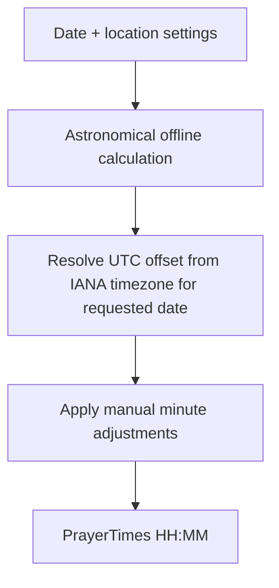

## Home prayer density and phone rail — 2026-11-25, local

The separate 2026-11-26 candidate displays the same offline-resolved place on Home, Settings and successful detection notices. GPS is described independently of the place label. Selected catalogue presets include the localized country; approximate matches retain “Near” and the existing 75 km bound. Custom names, exact coordinates, timezone/method/adjustments and denial recovery are unchanged; no geocoding request or additional geographic dataset is introduced.

Its Qibla follow-up names an explicit fresh fix using those fresh coordinates alone, with the same “Near” caveat. It never changes prayer location or reminders. Orientation reading can start automatically when the platform permits it; sensor permission requiring a gesture retains a consent action. Full acquisition time/accuracy, static/reference warnings and guidance remain available under Details. This changes Qibla presentation and sensor activation only; astronomical timings and geolocation consent remain unchanged.

The latest owner screenshot correction uses a shared phone rail and intrinsically sized wide cards with unchanged timing type. It supersedes the fixed wide-card minimum and individual phone surfaces; passive corner badges, current/next identity, dated recording, disclosure and split location behavior remain. One phone material owner replaces nested independent card blur. No calculation, date, availability, persistence, reminder or location-provider behavior changes. See agent/phases/HOME_PRAYER_RAIL_MOTION_LOCAL_2026_11_25.md.

The owner's follow-up screenshot requires whole phone prayer names and one-line times with smaller AM/PM. Grouped times use a baseline-aligned, nonwrapping digit/period pair; the secondary period scales to 0.75em. Below a 22rem content measure, existing xs/label tokens keep names/times complete without introducing another global type step. Shared row height follows those single-line contents instead of reserving wrapped-name or AM/PM tracks. Enlarged text still uses the existing roomier two-column reflow and all actions retain 44px targets.

## Home corner state and device-location control — 2026-11-25, local

The owner corrects inline status to floating top-corner check/circle/next-arrow badges, with no badge for future unrecorded prayers. Badges occupy no layout space, and the original desktop/tablet card dimensions, typography and materials are preserved. Localized hidden descriptions retain time and temporal/recorded meaning. The current marker is independent of the saved dated record; only trackedLocation counts as recorded. Now/Next is one line where it fits and naturally wraps at enlarged measures. The compact city/crosshair split control below timings replaces separate visible Change/Refresh actions: city still opens existing location settings, while the crosshair still explicitly requests fresh coordinates through the unchanged provider. Busy, failed-request retention, protected results and focus recovery are preserved. This supersedes earlier presentation descriptions only; calculations, availability/recordability, dates, DST, persistence and synchronization do not change.

## Home tracking dialog and dated recorded status — 2026-11-25, local

The approved presentation keeps tablet timers in the desktop card anatomy when the content measure fits, with a recorded check derived only from trackedLocation for the supplied dayKey/prayer. Legacy home records remain recorded; independently completed Sunnah/adhkar never imply attendance. Current/next and saved state remain independent. Home's exact record date and existing App-owned writes remain authoritative across calendar choices, midnight and Friday naming.

An eligible card opens the shared protected tracking overlay only on intent. Compact guidance expands inside the same sheet; wide desktop retains complete inline evidence. Read remains separate from marking completion, and no reading route is gated by recording. Done closes the overlay; changes use existing immediate persistence, not a draft/Save transaction. Dates and Now/Next persist above a manual timings/location disclosure. Existing prayer calculation, selected location/timezone/method, DST, eligibility windows, notifications and data contracts are unchanged.

# Prayer times, location, timezone, and DST

## Selection-only location settings — 2026-11-27 (local)

The owner's simplicity follow-up supersedes manual-field validation and the earlier manual-coordinate editing UI. The default page shows the saved place once, a primary Use my current location action, secondary Choose a city and calculation selection. City browsing exposes the complete existing offline catalogue without typing; search is optional filtering, never place data entry. Selecting a city supplies its coordinates and timezone. GPS retains exact device-supplied coordinates/timezone and the honest approximate-place label.

More settings is initially closed and contains a protected timezone selection, seasonal status and bounded Earlier/Later minute buttons with Reset adjustments. Timezone options reuse familiar catalogue city/country names and dated UTC offsets; an existing custom zone remains selected even outside catalogue coverage. Manual city-name, coordinate, timezone and number text entry and Save are removed. Existing custom saved names/coordinates/zones remain intact until an explicit choice changes them. Full calculation authority names remain inside the picker and its accessible description without repeated visible provider text. Newer selections cancel pending GPS. Calculation formulas, normalization, reminders and synchronization are unchanged.

## Named location summaries — 2026-11-25 (local)

Settings and shared location summaries resolve unnamed/coordinate-only locations against the existing offline city catalogue. A nearest entry less than 75 km away produces “Near city, country” in the active language; outside coverage, a neutral Device location or Saved location label avoids guessing. Custom names and exact recognized preset localization remain authoritative. This is approximate presentation context, not administrative-boundary geocoding. Precise saved coordinates, timezone, calculation settings and persistence are unchanged, and no coordinate/network request is added. Exact stored coordinates continue driving prayer calculations; the simplified Settings page no longer exposes coordinate entry.

## Home overview and location refresh — 2026-11-24 (local)

Home presents the existing five dated prayer models together and a passive elapsed-interval shade behind current/next text. The numeric countdown remains visible without live announcements. Next, current and the opened details are independent states; existing availability/recording windows, tracking day keys, Friday naming, midnight and DST behavior remain authoritative. Reviewed prayer guidance is unchanged.

At normal phone sizes, labels occupy the first summary line and names the second, with remaining time beside the next prayer. Logical start alignment is fixed independently of interval progress. Location now follows the timings, with grouped Change/Refresh actions; Change opens existing settings without adding a Home dropdown. Enlarged text reflows without clipping. The existing scroll animation is retained, with an interaction hold during location acquisition and result-dialog recovery.

Refresh beside the location explicitly detects fresh coordinates through the existing on-device provider and App callback. It preserves calculation preferences, replaces the old city label with honest device-location context, ignores stale requests and retains the saved location on failure. Results appear in a dismissible protected dialog without inserting a page banner; keyboard focus returns to Refresh. Existing location settings remain the selection destination. No geocoding, new prayer service or synchronization field is added.

## Reminder readiness — 2026-11-01

Settings → Notifications now brings the existing permission and test action together with the next configured instant, selected location/timezone and location recovery link. It reuses the current scheduler’s next-delay boundary and formats the instant in the displayed timezone. Completed routines may be suppressed by the existing only-incomplete setting. This is not confirmation of a pending native alarm or future delivery; Android and browser limitations are explained separately. No calculation, scheduling, content or saved preference contract changes.

## First-use reminder selection — 2026-11-01

New installations select prayer and main routine reminders during onboarding, with explicit OS/browser permission still required. Existing users retain saved choices. Optional Friday reading uses 09:00 on Friday, Friday dua 60 minutes before Maghrib, and pre-Fajr dua 20 minutes before Fajr, in the chosen prayer location's date-specific IANA timezone. These product reminder choices match existing contextual reading windows, not new religious-source interpretations. Taps open Al-Kahf or Comprehensive duas. Native contextual entries use the cancellable seven-day queue; web suspension/closure still requires a separate push service for dependable closed-app delivery.

## Larger expanded Home times — 2026-10-21

Owner follow-ups: the Now pill shares the routine CTA's semantic primary/foreground colors with a static gloss. Remaining-time digits increase from 14px to 15px in the footer and from 12px to 13px in the condensed copy, with the same 18px compact line footprint. The ring becomes a clean, thicker arc without clock hands and retains clockwise elapsed-interval fill: empty at the interval start and full when the next prayer is due. This is decorative redundancy for the exact numeric countdown, not a new timer or completion signal.

The owner approves 40% larger time digits inside the existing expanded Home summary dimensions. Period labels stay small; collapsed digits retain their previous size. Explicit glyph endpoints follow the same 220ms standard curve as the inherited card/footer/countdown transition, avoiding WebKit's stale inherited relative-font calculation after live resizing. Calculation, timing, emphasis, tracking, scroll thresholds and timers stay unchanged. At enlarged text in narrow cards, retain the existing natural full-row reflow instead of forcing extra enlargement. Both motion preferences cancel the transition immediately. Verify digit/icon/name/footer separation, equal card dimensions and bilingual fit in addition to timing-domain tests.

## Next-prayer seconds and interval ring — 2026-10-20, local only

The owner's subsequent approved WebKit restoration repair distinguishes native horizontal-list focus from an active prayer button. Closing details reconciles current scroll without moving focus; real keyboard focus on a prayer button still holds card geometry until it leaves. Horizontal browsing alone cannot leave closed cards stuck condensed at the top. Existing 96px/8px hysteresis, accessible region focusability and native horizontal scrolling remain.

The owner approves a small elapsed-interval ring replacing the clock outline, with localized HH:MM:SS. Mobile, narrow cards and the condensed summary omit the localized remaining-time word; the passive accessible description retains complete meaning. The ring is redundant with text and is hidden from assistive technology; no live region announces each second. This supersedes the summary's earlier no-progress-indicator rule for this small ring only.

The existing model passes current/next dated instants to one visibility-aware clock owned by the next summary card. It computes remaining time from the absolute deadline on each aligned second and resynchronizes after document visibility or horizontal-scroll visibility returns. Hidden/offscreen/expired/unmounted cards do no timer work. Home's minute clock still owns prayer rollover, availability, tracking and other derived state; no prayer calculation runs each second. Both summary copies share that clock. Midnight/DST, calculations, sunrise rules, saved records and reminders remain unchanged. OS/app reduced motion suppresses the brief seconds fade and arc interpolation while preserving accurate immediate numeric updates.

## Compact overview presentation — 2026-10-18

The owner's follow-up retains the previous icons and full-width temporal pills, requesting only tighter highlighted gaps and modest polish. The row is capped at 52rem with tighter header/footer padding and a 52px footer minimum. Existing visible temporal statuses, next countdown and accessible saved-state descriptions remain unchanged, as do openability, recording, chronology, Friday naming, calculation, reminders and stored data. Horizontal browsing and coordinated sticky collapse are preserved.

## Friday deed presentation — 2026-10-16

For a Friday record date, the noon action card uses the owner-approved Jumu‘ah name, three-action checklist and Friday evidence. It retains the internal dhuhr prayer ID, calculated noon time, record ownership, location/adhkar/sunnahAfter fields and all prior stored data. No prayer calculation or notification boundary changes. Before-Sunnah is not offered in Friday's checklist; existing values are retained. The approved sources and review status are recorded in CONTENT_AUTHORING.md.

Reminder reliability, 2026-10-13: permission changes are rechecked after returning from browser settings. Delivery uses an already active service-worker registration, avoiding an indefinite ready wait when none exists; supported desktop browsers may use their Notification constructor. Mobile rejection is reported as failure, with existing scheduled retry. Settings shows a pending test state and accurate background/closed-app limits. Prayer formulas and reminder times are unchanged.

This document is the source of truth for Azkarapp's prayer-time pipeline. It explains how times are calculated on the device, how daylight saving is applied, and how maintainers can verify or extend the feature safely.

## User-visible behavior

Owner stable-disclosure follow-up, 2026-10-16: expanded Home details span the summary row, with internal desktop information/checklist columns and fixed contextual cards below. All five prayers retain their existing opening/recording windows. Summary top/inline insets are now 14px. Checkbox verification exposed a presentation bug after clearing and rechecking a single Sunnah action: explicit false split fields masked its true aggregate value. Non-Dhuhr single-action presentation now accepts completion from either the aggregate or its relevant legacy split field; Dhuhr's before/after actions remain independent. No record shape, write handler, normalization, source text or calculation changed.

Latest owner follow-up, 2026-10-16: small cards have 12px top/side insets and a full-card pointer target via their existing native button, preserving unavailable future details and recording rules. Viewing copy is removed; aria-expanded and a quiet inset selection outline remain. Current loses decorative emphasis entirely once next enters the final 30-minute approach, while next retains its gradual increase. This supersedes the earlier current-to-50% surface handoff. All timing and source contracts remain unchanged. Local screenshots must be reviewed before another push.

Owner-approved emphasis follow-up, 2026-10-16: Home summary surfaces emphasize current most strongly, progressively transferring emphasis to next in the last 30 minutes before its dated adhan. The existing minute clock/timeline supplies this decorative strength; it does not change prayer calculation, validity, openability, recording, reminders or stored data. Previous/later surfaces have quieter reflections/borders while all labels and countdowns retain full contrast. No continuous animation or additional polling is introduced.

Owner follow-up, 2026-10-16, supersedes the overview footer description below: small Home cards no longer show Sunnah/Rawatib summaries. Next alone has an accented name/time, Next label and border, with remaining time and its native interval bar together inside its footer, outside the open button. Other footers show saved mosque/home, independently completed adhkar without inferring attendance, Not recorded for current/past unrecorded prayers, or After {previous prayer} for later prayers. Equal dimensions and complete enlarged text remain. Friday's supplied civil record dayKey changes the noon overview display name to الجمعة/Jumu‘ah; internal `dhuhr` identity, timing, routes and record writes remain unchanged. Reviewed expanded evidence/checklists are unchanged.

Prayer record dates on Home and the dedicated prayer screen follow the selected Hijri/Gregorian calendar and Hijri adjustment through the same formatter as the Home header. The displayed date is derived from the actual tracking dayKey, including after midnight; calendar changes affect presentation only and never move saved records.

The Home overview shows all five prayer timings in their usual order. Each bounded-width card has identity and timing columns. All fit on wide screens; smaller screens use native horizontal scrolling with a partial adjacent card and a named keyboard-scrollable region, without an All/Less button. Current and next are initially shown together where space permits; narrower rows reveal next with preceding-card context without moving the page vertically. The outer prayer surface is removed. Each standalone card owns a subtle boundary/material, aligned name/time row and readable status. Wide-screen cards fill the row equally; extra width separates their columns while actual header insets remain 8px at normal text size. Next owns the accent border and main timing/countdown area; the viewed prayer has a quiet localized label. The owner omits availability copy; disabled details retain the existing 30-minute openability rule. All cards now align with a shared footer height: every footer has one concise reviewed Sunnah summary, while saved state and next countdown remain in the main information area. The next interval bar remains outside the button, immediately above the footer. The expanded action panel shows the explicit saved record date instead of another timing/countdown line; record date assignment and prayer calculations remain unchanged. The next prayer includes a visible localized countdown and a native remaining-time progress bar, updated by the existing minute clock without live announcements or animation. The bar decreases over the interval between the previous and next adhan; it does not define religious prayer-window validity. Dated occurrences use the selected location/timezone and actual elapsed instants, including tomorrow's Fajr and DST changes. Past prayers retain today's tracking state. `prayerTimeline.ts` reuses the existing native reminder civil-time conversion, extracted unchanged to `content/locationTime.ts`. Settings → Prayer times & location allows the user to:

- Detect the current location
- Review the effective IANA timezone and current UTC offset
- See whether daylight saving or standard time is active
- Select a calculation authority
- Search and select a built-in city without sharing GPS data; the preset coordinates and IANA timezone remain available offline
- Browse all built-in cities without typing, or use device location outside catalogue coverage
- Optionally select a timezone and apply a minute adjustment with Earlier/Later buttons under More settings
  Prayer-time alert selection and lead time live separately in Settings → Notifications & reminders. The saved location, timezone, calculation method and minute adjustments still drive those alerts.

The five trackable prayers are Fajr, Dhuhr, Asr, Maghrib, and Isha. The same calculation also exposes Sunrise (Shrouk) as supporting Fajr-window context; it is never treated as a sixth prayer or given tracking controls.

Prayer reminders are opt-in and use the same locally calculated times and adjustments shown on Home. The Android app pre-schedules a rolling seven-day window with native OS alarms, so delivery does not depend on JavaScript running and alarms are restored by the OS after reboot. Android notification permission is required; exact timing also depends on Android's exact-alarm access and device power-management policy. The app refreshes the window when it opens and when reminder settings, completion state, language, or location changes. The PWA keeps its browser timer/service-worker behavior; browser suspension means dependable delivery after the PWA is completely closed still requires a connected server Push API service.

Home also uses the same calculated boundaries for its featured collection: Morning from Fajr to Asr, Evening from Asr to Isha, and Before Sleep from Isha to the following Fajr. The preferred Evening reading window is communicated as after Asr until Maghrib.

## Resolution flow



`getPrayerTimes()` is synchronous so Home always has an immediate value, and it is calculated on the device every time.

There is no network path and no daily cache. Prayer times were once fetched from `api.aladhan.com`, with the device calculation as a fallback; DEC-152 removed that call because it sent untruncated coordinates to a third party while the privacy page read as a promise that they never leave the device. The cached timings and the cached coordinate timezone went with it, and their storage keys are cleared on startup.

## How automatic DST works

The offline engine does not hard-code a `+2` or `+3` offset. It calls `getTimeZoneOffsetHours(date, timeZone)`, which uses `Intl.DateTimeFormat` and the IANA timezone database provided by the browser/runtime. The same timezone therefore returns different offsets on standard-time and DST dates when local law requires it.

For Cairo in 2026:

| Date       | Timezone       | Effective offset | Status                 |
| ---------- | -------------- | ---------------- | ---------------------- |
| January 15 | `Africa/Cairo` | `UTC+02:00`      | Standard time          |
| July 29    | `Africa/Cairo` | `UTC+03:00`      | Daylight saving active |

`getTimeZoneStatus()` samples the selected timezone across the calendar year. If offsets vary, the zone observes a seasonal change. The current date's offset is compared with the standard offset to display the active status in Settings.

### Automatic timezone source priority

When the user selects **Detect My Location**:

1. The browser Geolocation API returns latitude and longitude after permission.
2. `Intl.DateTimeFormat().resolvedOptions().timeZone` supplies the device timezone. Nothing is asked of the network, and the coordinates do not leave the device.
3. The selected timezone is persisted in `UserSettingsState.location`.

The Settings status card makes the effective timezone and UTC offset auditable. If a device is configured with the wrong timezone and the app is offline during detection, the user can correct the IANA timezone manually.

The built-in city selector is a convenience catalogue, not an online geocoder. Selecting a result immediately persists its representative city-centre coordinates and IANA timezone through the same `LocationSettings` boundary as manual entry. Search compares English names, Arabic names, countries, and common aliases without changing displayed text. Locations outside the catalogue remain supported through the manual fields.

## Calculation methods

|  ID | Authority                               |  Fajr |                     Isha |
| --: | --------------------------------------- | ----: | -----------------------: |
|   5 | Egyptian General Authority of Survey    | 19.5° |                    17.5° |
|   4 | Umm Al-Qura University, Makkah          | 18.5° | 90 minutes after Maghrib |
|   3 | Muslim World League                     |   18° |                      17° |
|   2 | Islamic Society of North America        |   15° |                      15° |
|   1 | University of Islamic Sciences, Karachi |   18° |                      18° |

Method definitions live in `CALCULATION_METHODS`. IDs follow the numbering Aladhan established, which is the convention users recognise from other apps, but nothing is sent there. Adding a method requires Arabic/English names, offline parameters, UI coverage, and parsing/calculation tests.

## Offline calculation

`calculateOfflinePrayerTimes()` derives:

- Solar declination and equation of time from the requested Gregorian date
- Solar noon from longitude and the date-specific timezone offset
- Fajr and Isha from the method's depression angles
- Dhuhr from solar noon with a small safety margin
- Standard-school Asr from shadow factor 1
- Maghrib from sunset at 0.833° below the horizon

High-latitude cases where the sun reaches sunset but not the selected Fajr or Isha angle use the angle-based portion of the night: `angle / 60 × night duration`. This preserves the normal calculation method on ordinary days and keeps Fajr before Dhuhr and Isha after Maghrib. Polar-day and polar-night results still need comparison with the user's local authority.

## Manual adjustments

Each prayer accepts an integer adjustment from -120 to +120 minutes. Adjustments are applied after the calculation. Values wrap safely across midnight.

Manual adjustments do not change the calculation-method parameters or timezone.

## Caching

There is none, and there is nothing to cache: the calculation is local, synchronous and cheap, so a cached copy could only ever be a slower way to get the same answer.

Two key families were written by the removed network path and are now swept on startup by `pruneExpiredPrayerTimes`:

```text
azkarapp.prayer_times_cache.<local-date>_<lat>_<lng>_<method>
azkarapp.prayer_time_zone.<lat>_<lng>
```

They are cleared rather than left to expire because their key names embed the coordinates of whoever last used the device.

## Failure and privacy behavior

Geolocation failure is classified as unsupported, permission denied, unavailable, timeout, or unknown. Settings gives reason-specific recovery guidance and keeps the previously saved location and prayer settings unchanged. Permission denial points to the browser's site settings; unsupported detection keeps manual latitude, longitude, city, and IANA timezone entry available.

Changing the calculation method is a local operation: the selected method is saved and the astronomical calculation uses it immediately.

| Condition                         | Behavior                                                      |
| --------------------------------- | ------------------------------------------------------------- |
| Geolocation denied/unavailable    | Keep existing/default location and show an actionable message |
| No network at all                 | Unaffected — every time is calculated on the device           |
| Invalid manual coordinates        | Reject the save and retain the previous settings              |
| Invalid/unavailable IANA timezone | Fall back to the device offset                                |
| `localStorage` unavailable        | Continue without caching                                      |

The API timeout is bounded. Geolocation is user-initiated and requires HTTPS or localhost. Coordinates are used for prayer timing and are not needed by Supabase account synchronization.

## Code map

| File                                               | Responsibility                                                     |
| -------------------------------------------------- | ------------------------------------------------------------------ |
| `src/app/content/prayerCalculation.ts`             | Timezone/DST, astronomical calculation, adjustments, geolocation   |
| `src/app/content/prayerTimes.ts`                   | Current/next prayer selection and countdown formatting             |
| `src/app/screens/HomeScreen.tsx`                   | Immediate fallback rendering and background refresh                |
| `src/app/screens/settings/PrayerLocationPanel.tsx` | Location, timezone status, methods, and adjustments UI             |
| `src/app/hooks/useForegroundReminders.ts`          | Exact next-due routine/prayer scheduling and notification delivery |
| `src/app/types.ts`                                 | `LocationSettings` persistence contract                            |
| `src/app/state.ts`                                 | Defaults, validation, merge, and persistence                       |
| `src/app/content/prayerCalculation.test.ts`        | Parser, timezone/DST, offline, adjustment, and fallback unit tests |
| `e2e/narrow-layout.spec.ts`                        | Narrow prayer-header overflow regression                           |
| `e2e/responsive.spec.ts`                           | Arabic RTL prayer-header fit                                       |

## Verification

Run:

```bash
pnpm test:run
pnpm check
pnpm exec playwright test e2e/narrow-layout.spec.ts
pnpm exec playwright test e2e/responsive.spec.ts --grep "Arabic Home"
```

For a manual location verification:

1. Open Settings → Prayer Times & Location.
2. Select Detect My Location and grant permission.
3. Confirm the displayed IANA timezone matches the location.
4. Confirm the displayed UTC offset matches the current civil time.
5. Check whether Settings reports DST or standard time.
6. Compare the five times with a trusted local authority using the same calculation method.
7. Disable the network, reload, and confirm the countdown is unchanged — it never depended on the network.
8. Test a date on each side of a known DST transition through unit tests rather than changing the device clock.
9. In the Android app, enable prayer reminders, select 10 or 15 minutes, reload Settings, and confirm the choice persists.
10. On a physical Android device, schedule a near-term reminder, swipe Azkar away, and confirm it arrives; repeat after reboot. Do not use Force stop for this check because Android suppresses alarms for force-stopped apps until they are opened again.

When local authorities differ by a few minutes, confirm the selected calculation method first, then use manual adjustments only when required.

Home clarity follow-up, 2026-10-14: the default overview presents current and next prayer only, with an explicit control for all five. Existing prayer calculations, sunrise bounds, next-day countdowns, future recording restrictions and recording models are unchanged.

## Packaged Android reminders — 2026-10-15

The approved host uses a bounded seven-day native notification queue. Prayer wall times resolve against the selected location IANA timezone with date-specific DST; routine reminders retain the device-clock contract. Changes, completion and app resumption replace owned pending reminders. Expired reminders are not replayed on reboot. Approximate alarm delivery, OEM battery restrictions, force-stop and the need to reopen at least weekly are stated in settings. See [Android acceptance](ANDROID.md); actual device delivery is not proven by web tests. The PWA continues using its existing foreground/service-worker notification behavior.

## Owner-approved frosted prayer hierarchy — 2026-10-17

The owner supplies a blue/gold prayer-row reference and approves comfortable horizontal cards that initially show current/next together, then scroll freely. Summary cards use icon tiles/dividers, larger times, temporal status pills and the existing native countdown interval bar; stored record facts remain in the button description and expanded action panel. Narrow rows rotate the overnight cyclic sequence to Isha then following Fajr so the pair can fit initially; wide rows keep ordinary chronological order. Reposition only on prayer/layout changes or keyboard/selected-card reveal, not during manual browsing. Current's pill is static gold with a quiet dot; no pulse or new clock. The earlier identity/time-on-one-row and saved-state-footer presentation rules are superseded. Calculations, record/openability rules, sacred text, outside selected edge and reduced-motion sticky behavior remain. See docs/agent/phases/PRAYER_GLASS_HIERARCHY_2026_10_17.md.

## Calm prayer and overlay separation — 2026-10-17

The owner's screenshot review supersedes the icon divider, bright blue/white summary outlines, next-prayer interval bar and 28% overlay tint. Prayer summaries use quieter boundaries and a text countdown, without vertical dividers or a progress bar. Keep current/next initial visibility, native free scrolling, recorded-state descriptions, full-card targets and stable name/time geometry through collapse. Expanded actions precede supporting evidence on phone; desktop retains separate evidence and tracking columns. Reviewed sources and tracking/calculation behavior are unchanged.

Text-over-text overlays require a denser material than cards: dialogs, menus, listboxes and expanded audio use 80% navy with stationary 28px/135% frost. Ordinary cards and reading tint retain their existing values. Expanded AudioPlayerSurface visually hides its covered main-canvas siblings using a reversible attribute, in addition to inert/aria-hidden, and restores them on collapse. The shared shell scene remains visible; transparent backgrounds cannot reveal duplicate Reader text. Native focus, Escape, touch lock, Solid/high-contrast/forced-color recovery and offline state remain. See docs/agent/phases/CALM_PRAYER_AND_OVERLAY_SEPARATION_2026_10_17.md.

## Progress-only tracking panel — 2026-10-18

The owner clarifies Progress as a read-only statistics surface. Daily summaries derive saved counts; a collapsed native table exposes prayer locations and independent Rawatib/azkar facts. No timing decoration, recording controls or prayer-entry routes are shown. Missing records are explicitly distinguished from missed worship. Home continues owning prayer times, guidance and recording under the unchanged eligibility rules. No calculation, religious content, reminder, timezone, normalization or persistence change. Local phase: docs/agent/phases/PROGRESS_COMPACT_TRACKING_2026_10_18.md.

## Progress recording patterns — 2026-10-18, local only

The owner supersedes numeric tables and metric dropdowns with daily read-only status rows and historical comparisons for obligatory prayer, Rawatib and prayer azkar. Obligatory recording counts explicit home and mosque locations equally; optional practices remain independent and Asr remains excluded from Rawatib. Historical prayer comparisons include complete civil days only, independently of the devotional-day rollover, with absence explicitly distinguished from missed worship. Home recording, prayer times, religious source material and persistence are unchanged. Exact selected-period counts and location totals are available through an explicit JSON download. See docs/agent/phases/PROGRESS_ACTIONABLE_INSIGHTS_2026_10_18.md.

## Local adjacent adhkar reading action — 2026-10-18

The owner-approved card refinement moves the reading route into a separate button beside the after-prayer completion checkbox. The checkbox alone writes the existing record; the reading button never writes completion. Existing mosque labels, record day, Fajr sunrise, calculations, future eligibility and offline behavior remain. The complete unchanged virtue/source moves into a disclosure on narrow cards and remains visible beside actions when the card has 40rem available. Theme colors and shared Glass/fallback rules remain authoritative. See docs/agent/phases/PRAYER_ACTIONS_ADJACENT_READING_2026_10_18.md. Local only; no push.

## Prayer evidence alignment and secondary record context — 2026-10-18, local only

The owner requests removing the visible record line, aligning virtue with the title and keeping its citation inline. Move the same explicit time/dayKey/date label into the existing information sheet; no date assignment or calculation change. On wide cards, align the evidence heading at the prayer title top edge and span its column alongside the title/checklist. Fajr sunrise remains directly beneath its title. Append the unchanged source as a smaller inline span after the complete quotation; allow natural wrapping when the final line has insufficient room, never truncate or alter devotional text. Keep the established narrow disclosure, reading button, semantic colors, Glass/fallbacks and keyboard targets. This supersedes the earlier upper evidence-column record line. No push.

Browser and Android delivery share Arabic and English notification copy. The title identifies the prayer or reading. A prayer reminder at its scheduled time uses a due-now title. An advance reminder gives the selected lead time. Reading reminders describe the destination, while the test notification confirms test receipt only. Existing calculation, time, permission, route and delivery policies are preserved.

## Approved notification relevance

Prayer reminders now share dated selected-location instants between browser and Android, including the correct civil date and DST offset. Routine reminders retain device-clock choices. The local Android queue has one scheduling owner and removes alarms from the former competing scheduler. Copy rotation uses the scheduled prayer date and retains prayer-specific narration conditions. Titles record the calculated prayer clock time rather than a countdown that could become stale.

Browser delivery expires after at most five minutes. Advance-prayer messages expire by the prayer instant. Friday dua stays after Asr and before Maghrib. The twenty-minute pre-Fajr reminder uses the last-third quotation only if that instant is inside the calculated previous-Maghrib-to-Fajr last third. Native OS delays still require physical-device acceptance.

### Optional contextual alerts

Pre-Fajr dua requires an explicit choice for new readers. Previously saved choices continue to apply. Friday Salawat and Monday/Thursday fasting preparation start off. The Friday alert uses 10:00 in the selected prayer location, after sunrise and outside the immediate prayer window. Preparation uses 45 minutes after Asr on Sunday or Wednesday, with the full delivery window at least 30 minutes before Maghrib. These are app reminder times. The fasting check uses the saved Hijri offset and the existing conservative margin around Ramadan, Eid and Tashriq. Dates without reliable eligibility are skipped.

## Qibla-only location and north reference — 2026-11-24

Qibla refresh requests maximumAge zero and uses the returned coordinates only for that screen. Acquisition timestamp, accuracy radius and optional altitude are displayed/used when supplied. It never changes saved prayer coordinates, timezone, method, adjustments or reminders. Fresh coordinates show Device location because the app has no approved reverse geocoder; the former saved-city name is not reused.

Compass headings are magnetic on the supported WebKit/absolute orientation paths. Offline WMM2025 correction converts them to true north before comparison with the existing great-circle bearing. The degree-12 harmonic evaluator follows Android GeomagneticField (Apache-2.0; license in third-party/GEOMAGNETIC_LICENSE.txt); coefficients are public-domain NOAA/BGS WMM2025 data from https://www.ncei.noaa.gov/sites/default/files/2024-12/WMM2025COF.zip. All 100 independent bundled NOAA test vectors verify declination and north/east/down/horizontal fields. This is numerical model validation, not physical handset acceptance. The model rejects dates outside 2025–2029, unsupported altitude and horizontal field below 6000nT for guidance. Replace coefficients and revalidate with the next official model before 2030. No coordinate leaves the device.

Official sensor contracts: https://developer.apple.com/documentation/webkitjs/deviceorientationevent/1804777-webkitcompassheading and https://www.w3.org/TR/orientation-event/. A separate physical compass must use true north or its own appropriate declination correction. Sensor uncertainty, magnetic interference and device calibration remain limitations; unknown or poor accuracy cannot be described as guaranteed correctness.

Model maintenance: MAGNETIC_MODEL records epoch 2025, exclusive validity year 2030 and review date 2029-07-01. A real-clock test in the normal unit suite becomes a failing release gate at the review date, six months before correction expiry. Install the official successor and its independent vectors, verify correction sign/reference, date/altitude/weak-field bounds and real-device behavior, then revise the metadata and gate together. No scheduled automation or new service is required. The location-warning threshold of 100 metres is a conservative UI prompt, not a geolocation or Qibla accuracy guarantee.

## Prayer settings clarity — 2026-11-24, local

Settings separates the used location, method and advanced adjustments. The compact location summary retains the selected IANA zone/UTC offset with disclosed seasonal explanations. GPS uses the device-provided zone and an honest Device location/coordinate label; it does not perform reverse geocoding. City search remains the built-in offline catalogue and opens in a protected shared sheet/dialog. City choice never changes the calculation method or minute offsets.

The five existing method definitions and IDs are unchanged. A short closed label is accompanied by the full authority name. Selection applies immediately through the existing callback, works offline and persists normally. Phones use a bounded opaque sheet; wide screens use the shared anchored select. Result notices no longer insert a banner into the form. Pending GPS is superseded by a city flow, method, manual save or adjustment, and ignored after unmount. Date/zone-keyed status avoids repeated seasonal sampling during typing while foreground/date refresh stays live. No religious content, prayer formula, timezone fallback, reminder or persistence contract changed. Physical-device acceptance remains pending.

## Inline desktop guidance and recording date — 2026-11-24

The owner supersedes the recording-date-in-information-sheet presentation. Home and the focused prayer card now show the same native time element directly in the card at all widths. It still formats the supplied tracking dayKey with the selected calendar and Hijri offset, including across midnight. Desktop exposes the unchanged Sunnah data and complete supporting evidence; compact screens retain the information dialog. No calculation, reminder, recording window, Friday identity, persisted field or source wording changes.

The subsequent approved final reference places the complete passive citation beneath each quotation through one shared presentation component. This supersedes the older inline-virtue-citation presentation only; all quotation/reference strings, calendar identity, counts and recording behavior are unchanged.

### Selected desktop Concept A — 2026-11-24 follow-up

The latest approved desktop presentation groups checklist and the exact native recording date in one opaque theme-derived inset, retains independent Read/recording controls and both complete content columns, and moves Collapse to the far reading edge when space permits. Section gaps are 24px and complete quotations use the existing 18px step; references/grade/rank and all supplied calendar/dayKey semantics are unchanged. Narrow/enlarged layouts continue to reflow; compact information dialogs and keyboard recovery retain the preceding contract. See docs/agent/phases/PRAYER_CARD_CONCEPT_A_RELEASE_2026_11_24.md.
