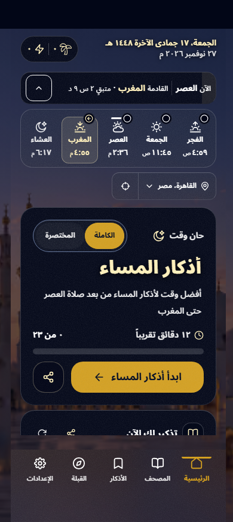
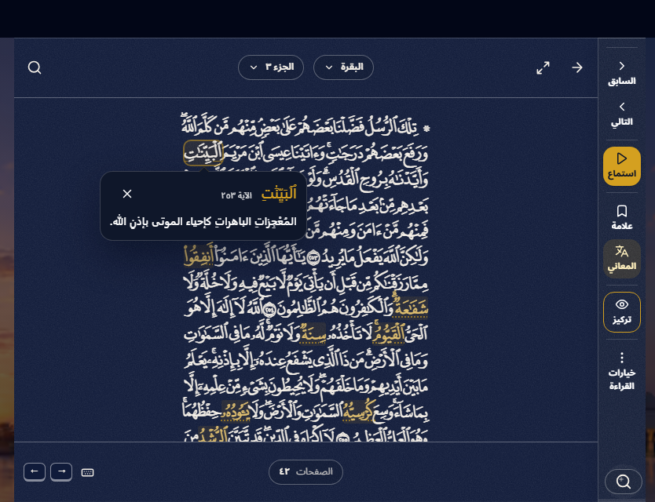
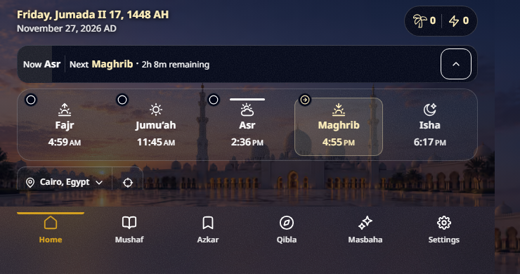

# Android safe-area evidence — local 2026-11-27

These are actual application browser captures with explicitly simulated Capacitor CSS insets. They contain no fabricated Android icons and do not prove physical Vivo/Android acceptance. Ordinary browser fallback and zero-inset wide views are checked separately in `e2e/seamless-system-bars.spec.ts`.

- Arabic Home: 390×872 CSS px, top 48/right 12/bottom 48/left 18 px. Header content and all bottom actions stay inside the usable rectangle.
- Arabic word explanation: 834×640 CSS px with the same asymmetric insets; the gloss remains opaque, bounded and closeable outside the reading canvas. The wide index is also measured in this case.
- English landscape: 740×390 CSS px, right cutout 36/bottom 24 px; navigation remains hit-testable inside the safe bounds.

Full browser screenshots, geometry assertions and failed-attempt traces remain in ignored `output/android-safe-area/`. See the [phase report](../../reports/ANDROID_SAFE_AREAS_LOCAL_2026_11_27_REPORT.md) for exact runs, APK identity, full-gate limitations and pending physical acceptance.
