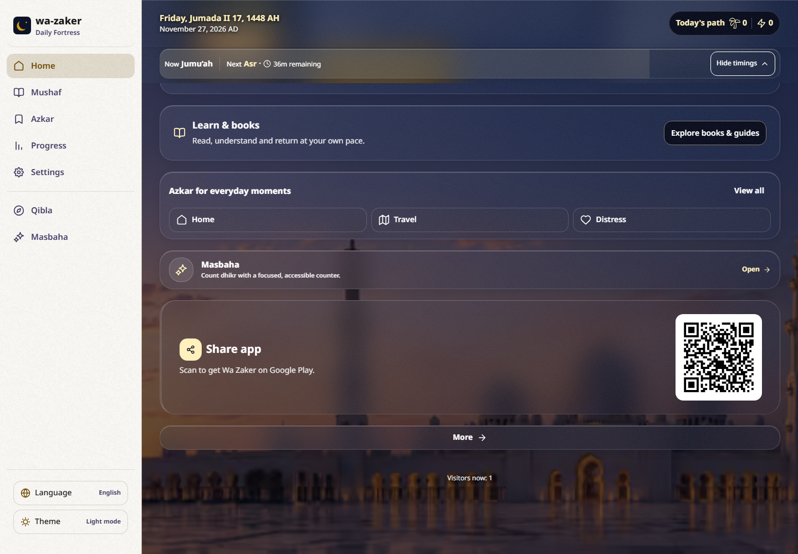
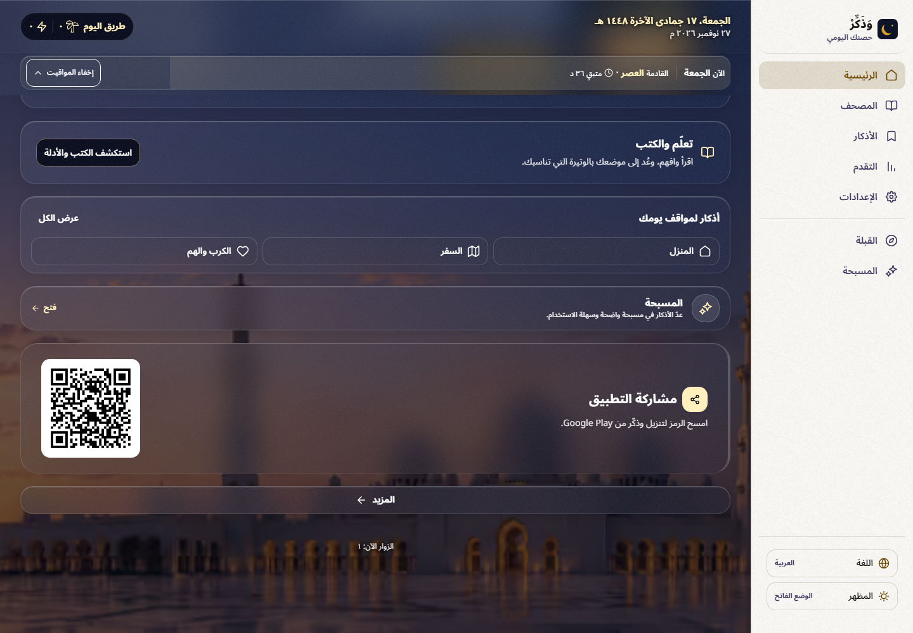
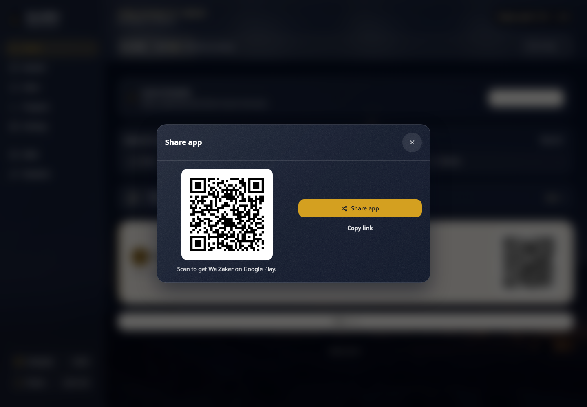
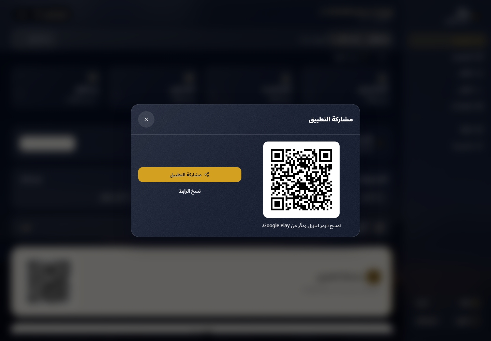
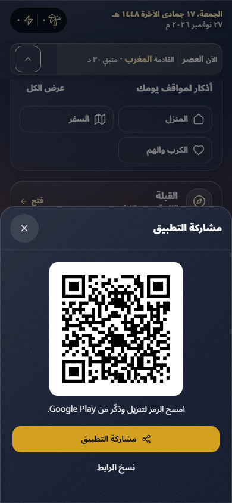
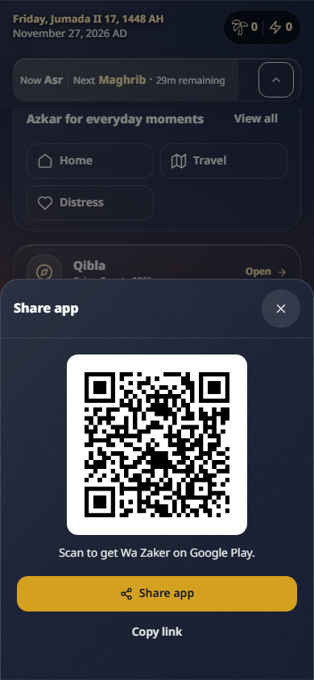
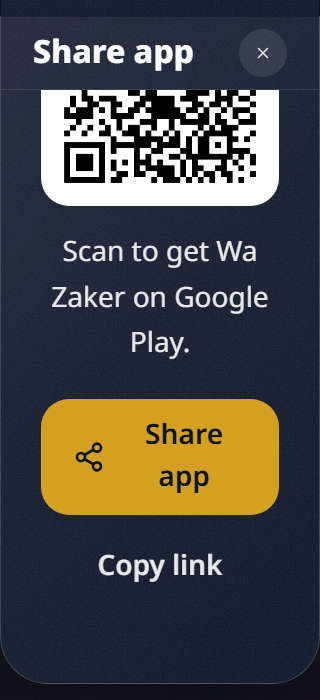

# Simple local application sharing — 2026-11-27

The owner's later color-glitch review supersedes the original solid sharing-card paint on Glass Home. See the [corrected material gallery](../home-material-colors/README.md) and [verification report](../../reports/HOME_MATERIAL_COLOR_LOCAL_2026_11_27_REPORT.md). Desktop Home captures below are refreshed to the corrected palette; the simplified sharing actions and horizontal dialog remain.

Actual application screenshots after the owner's simplification request. The QR, one primary Share app action and quiet Copy link replace the earlier destination picker and separate QR/link/save controls. Exact verification results and physical-device limitations belong to the [phase report](../../reports/APP_QR_SHARING_LOCAL_2026_11_27_REPORT.md).

## Desktop Home, English, 1440px

One public Google Play QR invitation below the devotional tools; compact layouts retain its same trigger without an inline QR.

The desktop follow-up separates the logical-start title/caption and filled sharing cue from the opposite-edge QR. Its opaque ground retains contrast over Home photography.

## Horizontal desktop dialog, RTL/LTR

At 900px+, the protected dialog places the QR/caption beside Share/Copy/feedback. The final layout is verified at 900px/200% text and 1440px, with both languages and three browser engines. Phones retain stacking.

## Phone, Arabic, Midnight/Glass, 390px

One QR, one short caption, one primary action and quiet Copy. The code has an opaque white ground and the protected sheet obscures underlying text.

## Phone, English, Midnight/Glass, 390px

The same composition and native keyboard order in LTR.

## Narrow phone, English, 320px/200% text

The content scrolls so the complete QR and each action can separately enter the viewport. Controls reflow without removing text; the close header remains available.

Full final captures: `output/playwright/app-sharing-simple/`. Automated geometry, payload, keyboard and axe checks do not replace physical scanning, Android chooser/provider checks or human assistive-technology acceptance. No commit, push or publication.
