# Approved completion greeting — actual application screenshots

These are rendered local application captures from the owner-approved blessing, quiet summary, 4px spacing and larger-check follow-up. They are not generated concepts. Images were copied without editing; [capture-manifest.json](capture-manifest.json) records each original browser artifact and SHA-256.

The Arabic greeting is `بارك الله فيك · تقبّل الله منك`. The completed collection is the single h1. The completed-zikr count is absent; optional streak feedback is inside Session details. Main/card/action spacing steps are 4px larger, with a 56px circle and 28px check glyph. Phone/tablet retain a compact page; desktop retains a modal with a separate check/Close toolbar.

## Phone

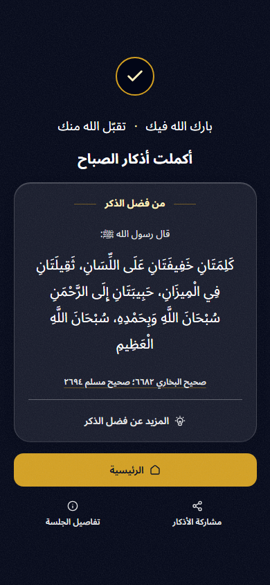

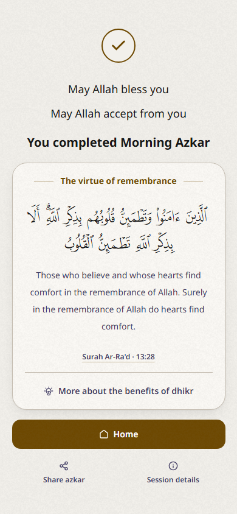

## Desktop modal

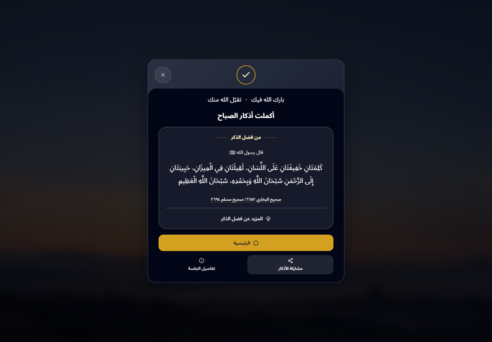

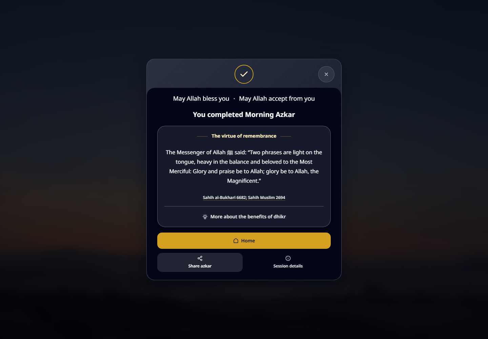

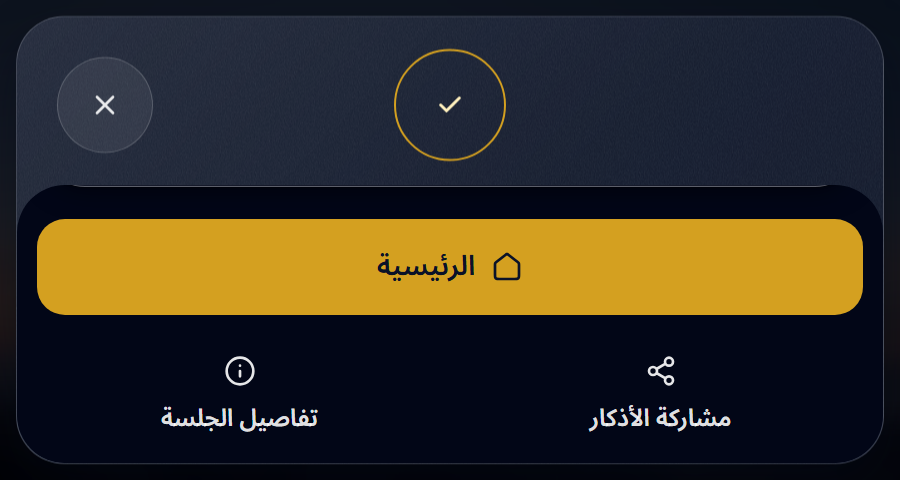

## Optional progress in details

The nineteen-day streak below is synthetic test data. It is absent on the main completion screen and only appears in the opened details dialog when quiet progress is enabled.

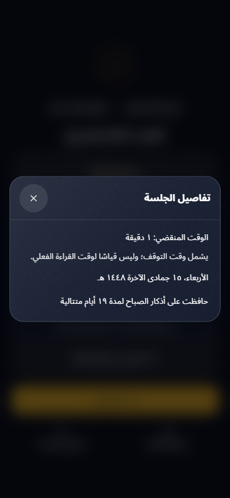

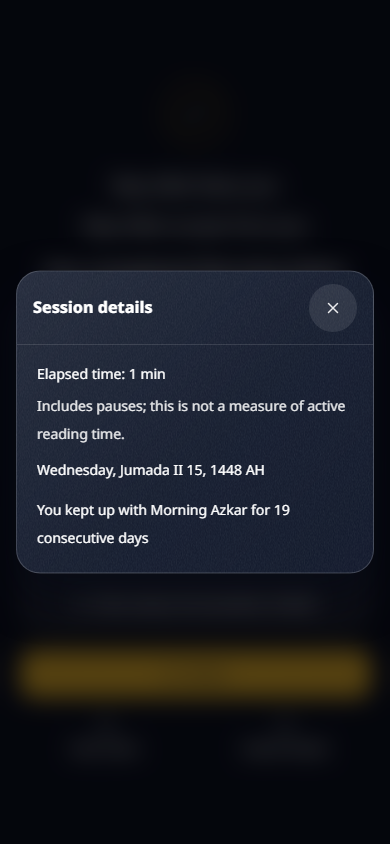

## Short-phone reading recovery

The following 360 × 650 core-routine captures simulate native 28px top / 20px bottom inset delivery. The quotation alone scrolls; source, Benefits, Continue/Home and secondary actions retain their geometry. Simulated browser insets do not establish physical Android acceptance.

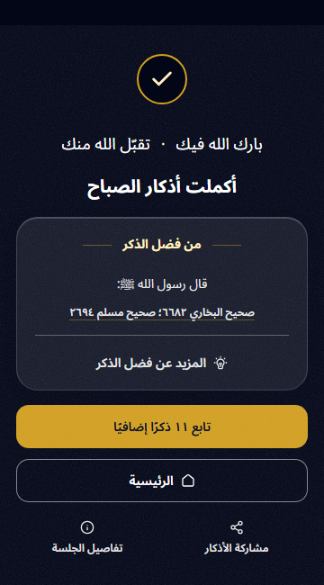

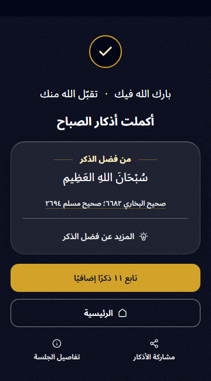

## Narrow, tablet and other action states

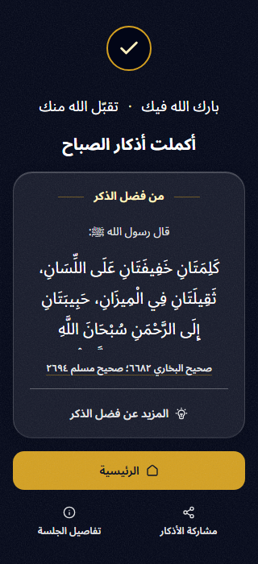

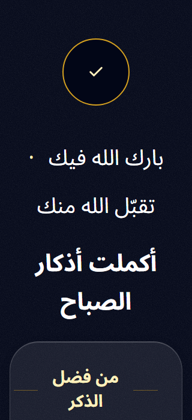

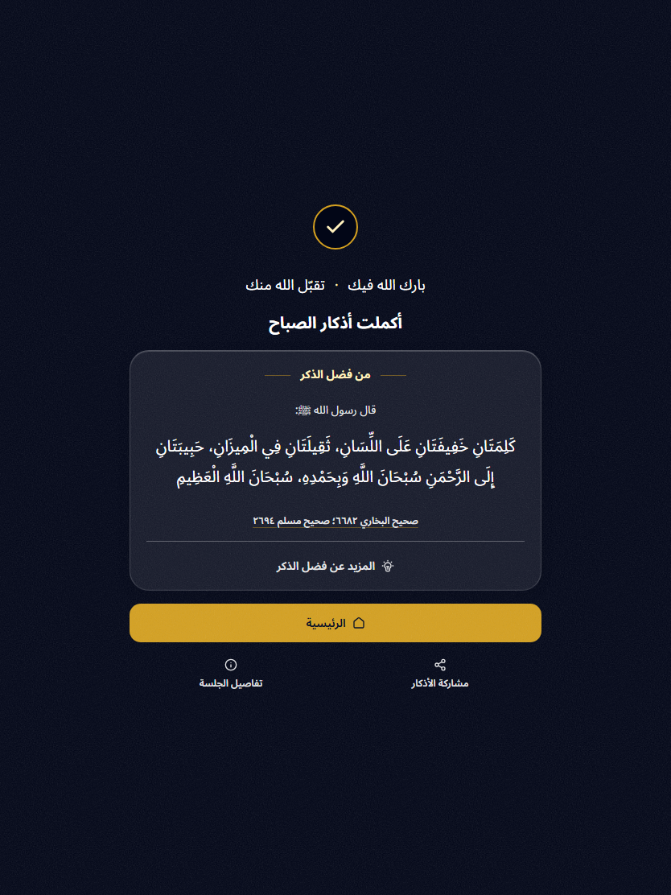

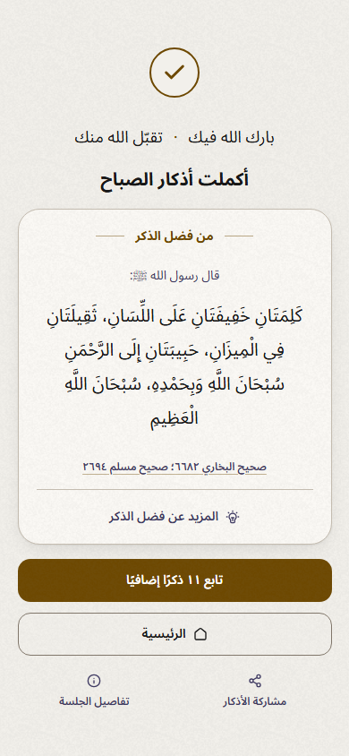

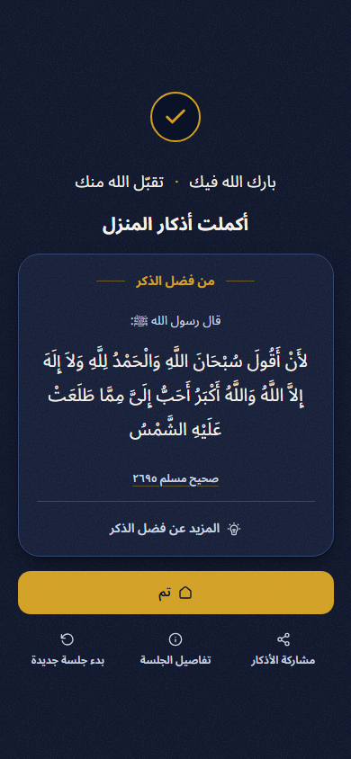

The [phase report](../../reports/COMPLETION_GREETING_LOCAL_2026_11_27_REPORT.md) records exact verification and repository-gate limitations. No production user data was used and no publication was performed.
