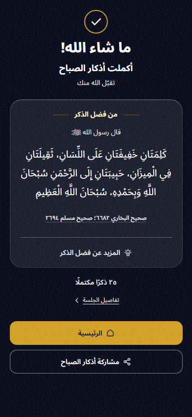
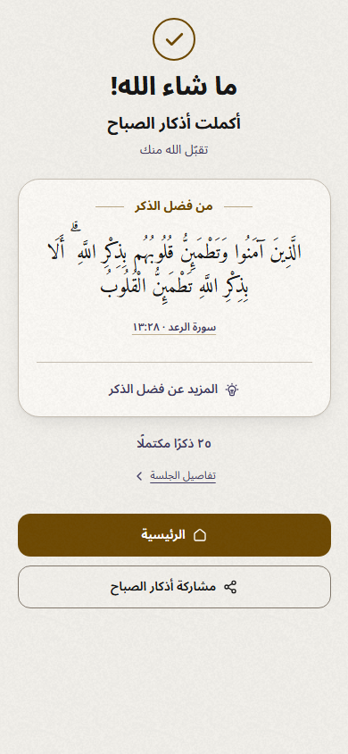
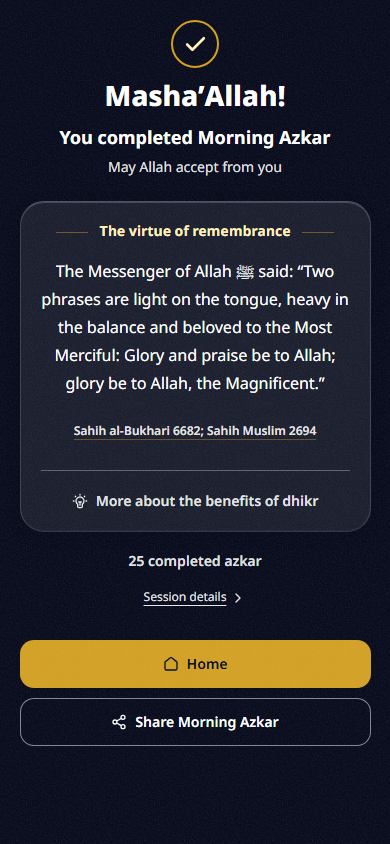
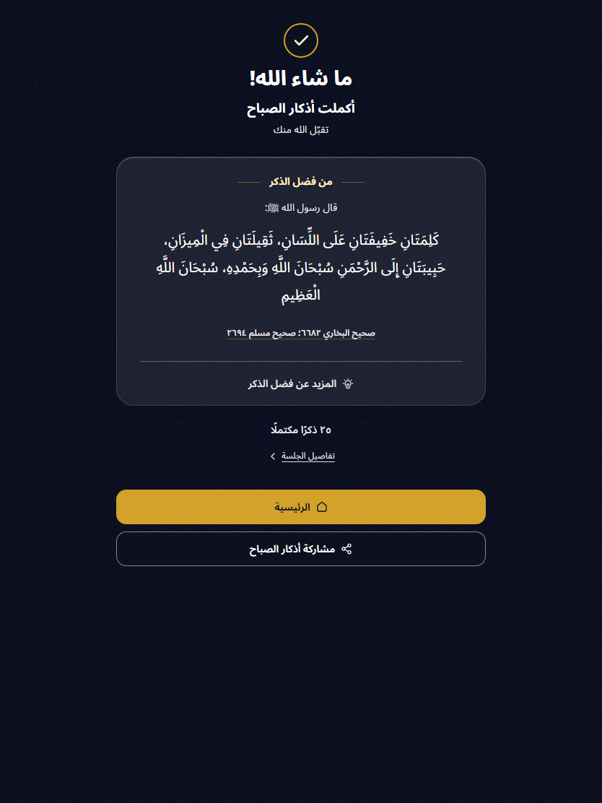

# Completion reflection — actual app evidence

Owner-approved local implementation, 2026-11-25. These images are rendered by Chromium from the isolated application build, not generated design concepts. The full browser report also exercises Firefox and WebKit. Production remains unchanged.

| Navy reading card                                                              | Light Quran card                                                         |
| ------------------------------------------------------------------------------ | ------------------------------------------------------------------------ |
|  |  |

| English phone                                                                   | Arabic tablet                                                                  |
| ------------------------------------------------------------------------------- | ------------------------------------------------------------------------------ |
|  |  |

Additional captures cover Arabic/English in all three themes at 390×844, 834×1112, 1440×1000 and 320×700 with 200% text. The enlarged-text screenshots show the initial scroll position; browser geometry and hit-testing additionally exercise the controls below it. Glass uses an opaque reading ground. Native text/source fidelity, equal card insets, no horizontal overflow and 44px targets are asserted separately from screenshot review.

Actual exported first cards: [Arabic](completion-ar.png), [English headings](completion-en.png). These are the collection's actual reviewed azkar, repetitions and sources. Long readings continue onto additional cards under the existing complete-content export rules; personal completion, elapsed time and streaks are absent. The retained PNG tests explicitly select the current card after verifying the all-card default.

The [phase report](../../reports/COMPLETION_REFLECTION_LOCAL_2026_11_25_REPORT.md) records exact commands and acceptance limits. Human assistive-technology, physical-device and final owner aesthetic acceptance remain separate.
