# Completion density follow-up — actual application screenshots

These 2026-11-27 screenshots show the owner's follow-up: remove blank bands inside the reminder and increase outer top/bottom breathing room. They are actual application captures, copied without editing. [capture-manifest.json](capture-manifest.json) records original browser artifact paths and SHA-256 values. The [earlier gallery](../completion-viewport/README.md) preserves the superseded stretched-card checkpoint for comparison.

The desktop follow-up uses the shared protected modal, with a dedicated check/Close row outside scrolling text. Sixteen selected screenshots cover the final phone/tablet/page and desktop/modal presentations.

The selected images use Chromium. The nineteen-day streak is synthetic test data; short-phone examples simulate native 28px top / 20px bottom insets while the screen's own minimum bottom padding is now 24px. They do not establish physical-device or screen-reader acceptance.

## Arabic phone

390 × 844, Midnight / Glass. The quotation follows the heading directly; source and Benefits follow the quotation. All available actions remain on the screen.

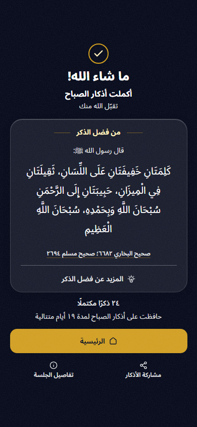

## Short phone: internal scrolling

360 × 650 with simulated insets. The quotation scrolls; surrounding card, source and actions retain their bounds.

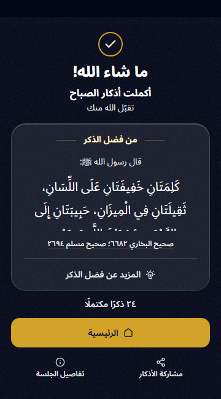

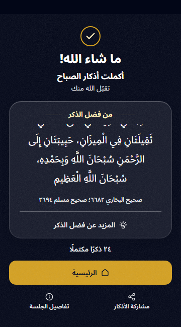

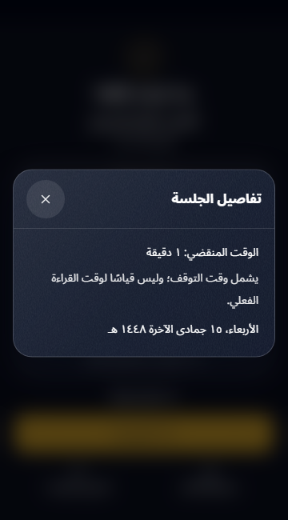

## Desktop modal with Close

At 900px and wider, completion appears as a centered protected modal. Close and Escape return Home; dismissing Session details or sharing restores the completion action instead. The check/Close row remains outside scrolling content so enlarged text cannot pass beneath Close.

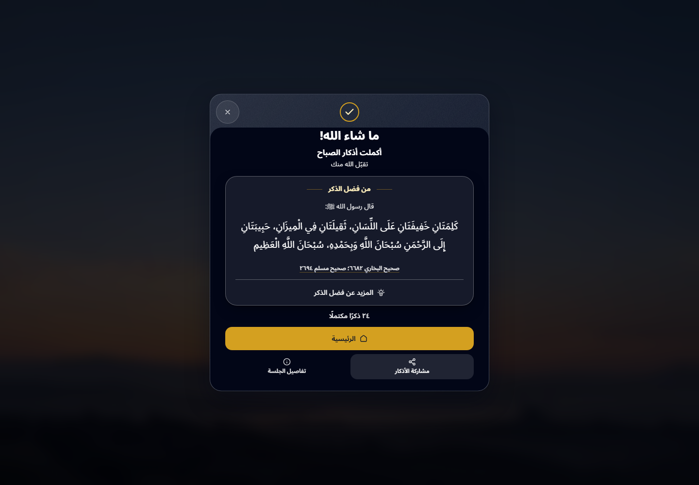

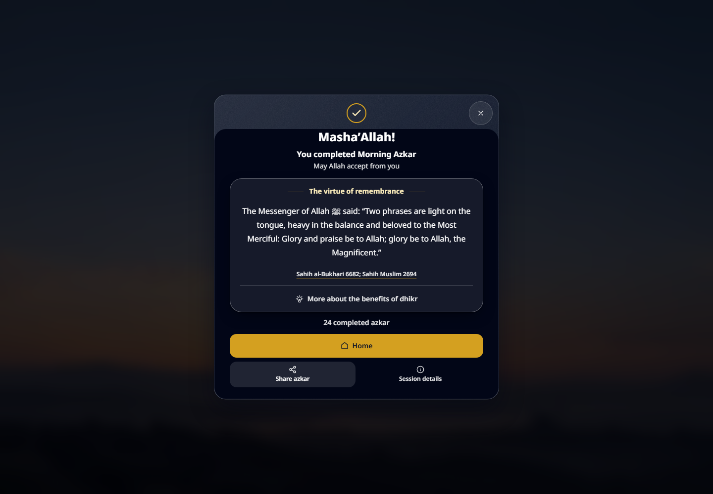

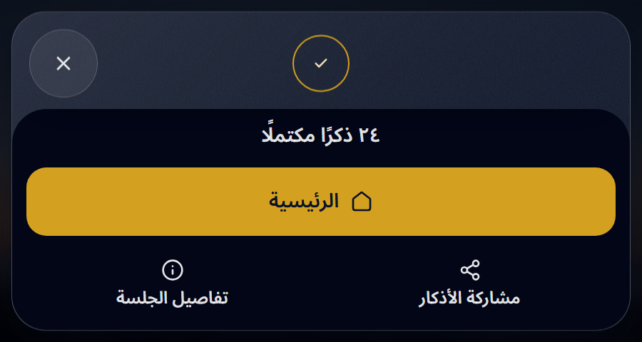

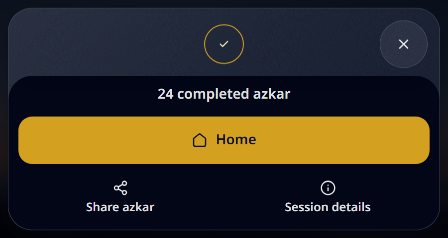

## English and responsive composition

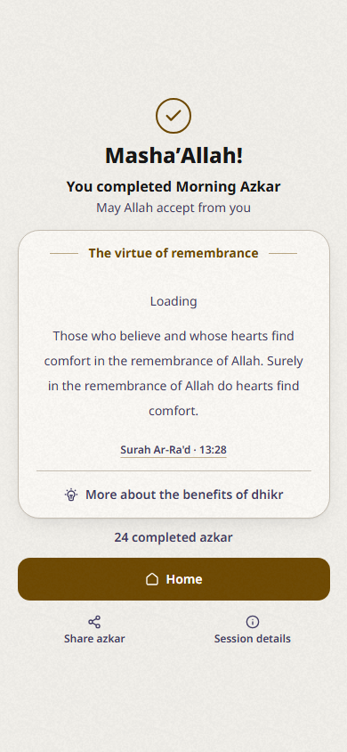

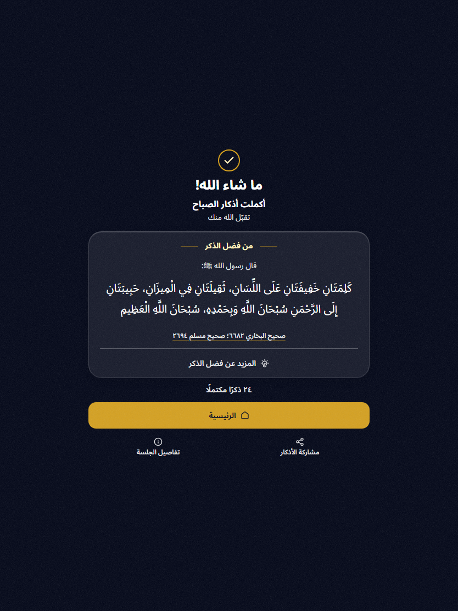

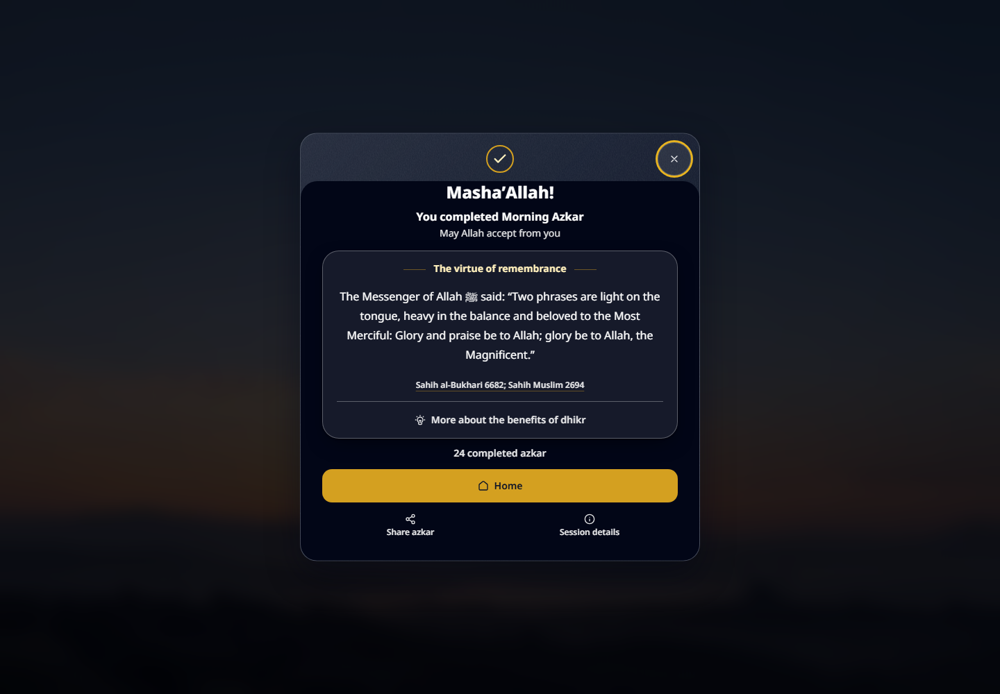

## Narrow, enlarged and alternative actions

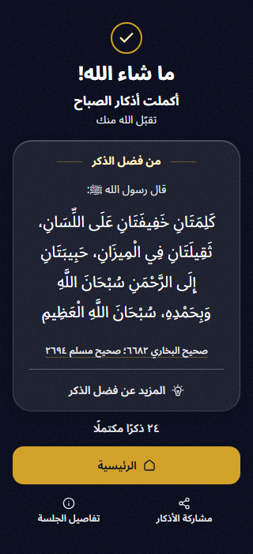

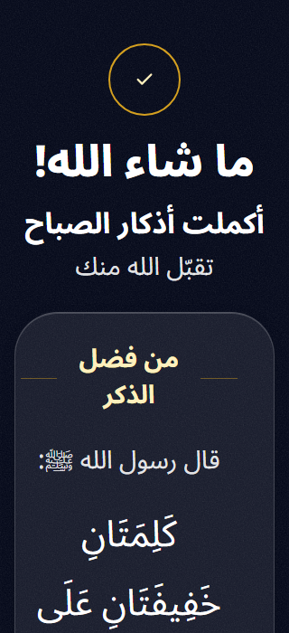

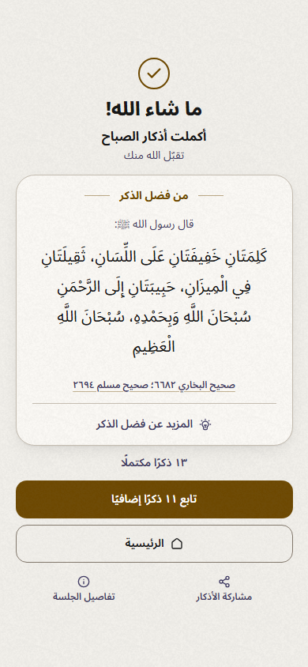

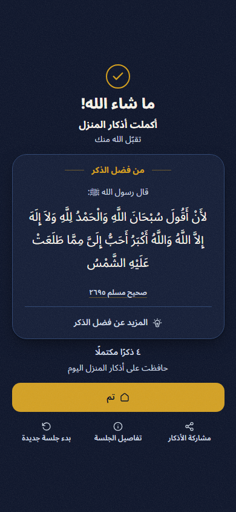

[Ordinary phone without a streak](ar-phone-midnight.png) is retained too. The [follow-up report](../../reports/COMPLETION_DENSITY_LOCAL_2026_11_27_REPORT.md) records verification and remaining repository-gate limitations.
