# Completion viewport — actual application screenshots

Captured locally on 2026-11-27 by the completion/session Playwright specs. These are the rendered application, not generated design concepts. The selected originals are copied without image editing; [capture-manifest.json](capture-manifest.json) records their source paths and SHA-256 hashes. All selected images use Chromium; the same feature cases also pass Firefox and WebKit.

The nineteen-day streak is synthetic test data. The short-phone examples simulate native CSS inset delivery (28px top, 20px bottom); they do not show a physical Android device or establish native/TalkBack acceptance. The offline restart image follows a real stopped test-owned origin. No production user data or traffic is involved.

## Ordinary Arabic phone

390 × 844, Midnight / Glass. The full available action group is visible without page scrolling; the optional streak retains its place.

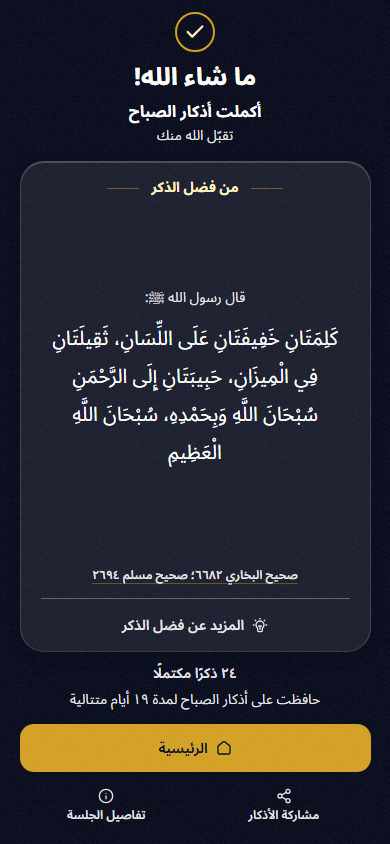

## Long quotation in a short phone viewport

360 × 650 with simulated native insets. Only the quotation scrolls: compare the identical card, source, Benefits and action positions at its beginning and end.

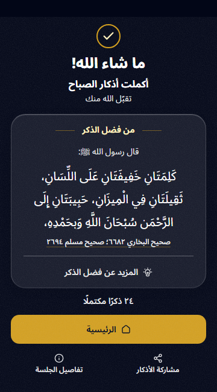

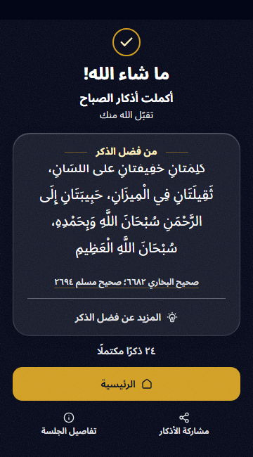

## Session details

The protected, content-sized dialog shows frozen elapsed time, its pause explanation and date. Close/Escape restores focus without moving the card.

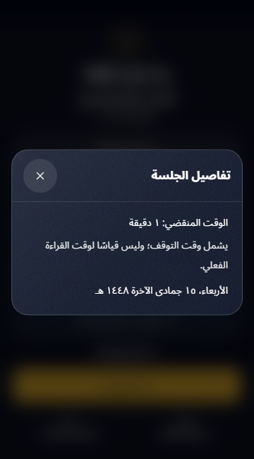

## English and Quran meaning

390 × 844, Light / solid; unchanged reviewed Arabic Quran with its existing English meaning.

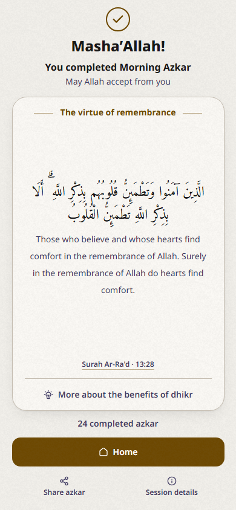

## Abbreviated routine and restart

Continue remains primary for abbreviated routines. A situational collection retains Done, actual-collection Share, details and New session after offline completion.

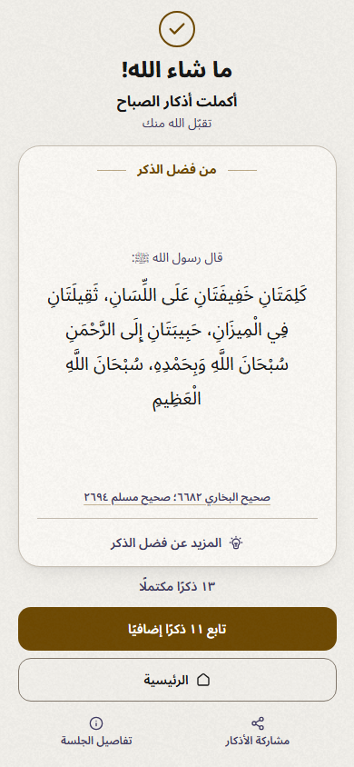

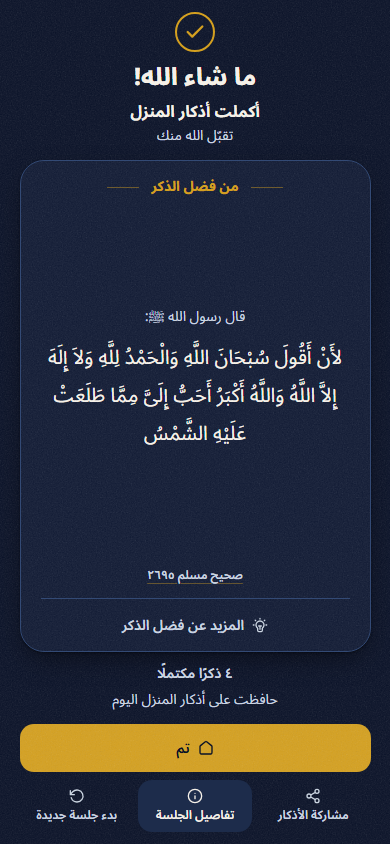

## Responsive and text recovery

The ordinary 320 × 700 screen fits its available actions. At verified 200% text it uses intrinsic page scrolling; this image shows the top, and the browser tests separately scroll to and hit-test every control.

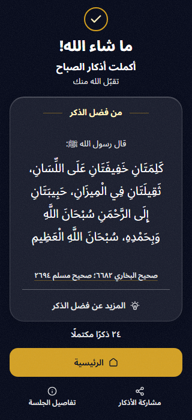

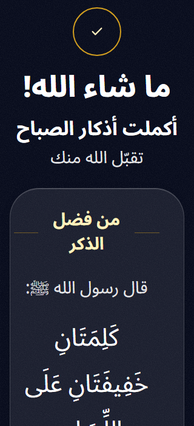

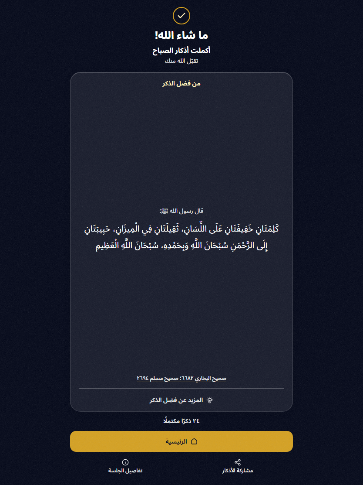

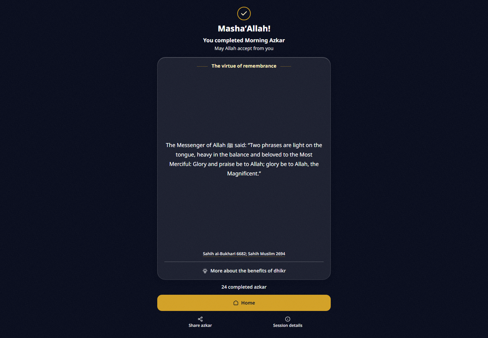

[Ordinary Arabic phone without a streak](ar-phone-midnight.png) is also retained. See the [phase report](../../reports/COMPLETION_VIEWPORT_LOCAL_2026_11_27_REPORT.md) for exact checks and limitations.
