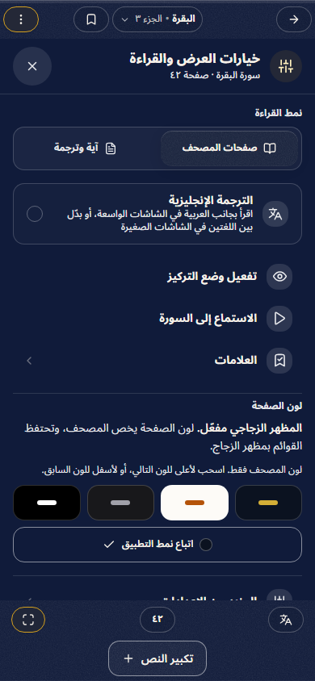
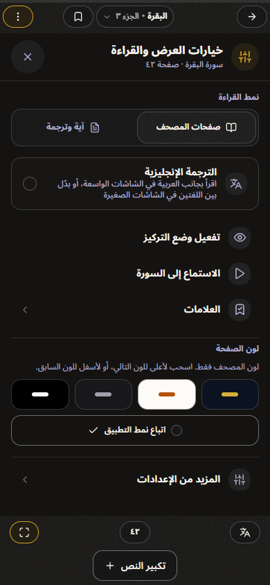
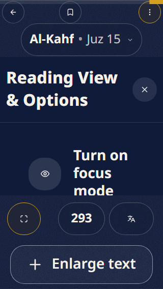
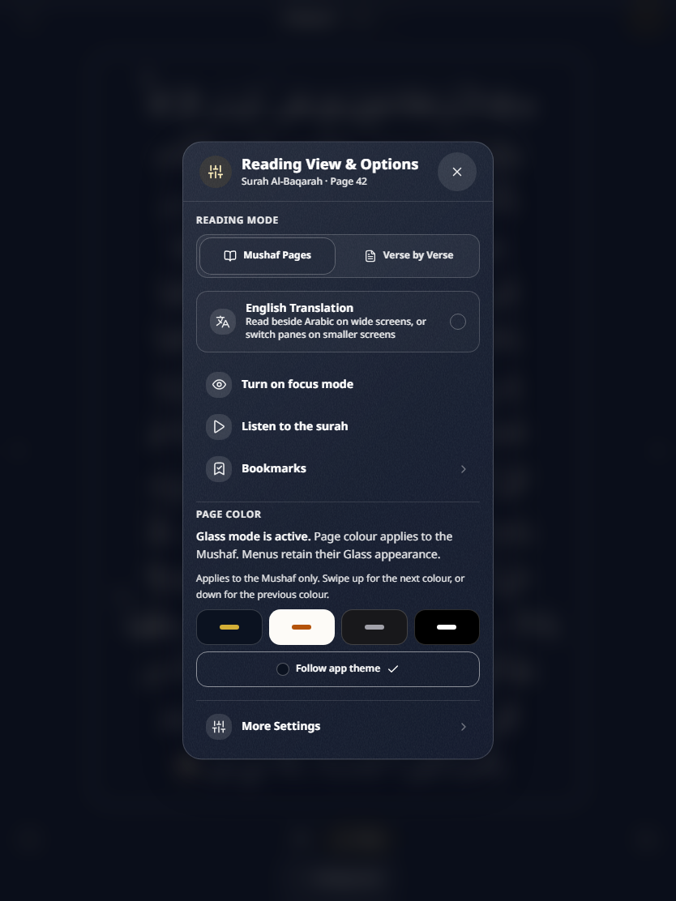

# Global overlay consistency — local evidence, 2026-11-25

Actual application screenshots, not mockups. Both Mushaf readers retain the reading page while ordinary tools occupy the content area between usable bars. Larger tasks on tablet/desktop keep their shared dialog or docked presentation.

| View                         | Evidence                                              |
| ---------------------------- | ----------------------------------------------------- |
| Arabic options, 390px        | [Phone](phone-ar-options.png)                         |
| English options, 390px       | [Phone](phone-en-options.png)                         |
| Arabic dark page color       | [Dark options](phone-ar-dark.png)                     |
| Arabic, 320px and 200% text  | [Enlarged](phone-ar-200-percent.png)                  |
| English, 320px and 200% text | [Enlarged](phone-en-200-percent.png)                  |
| Tablet options               | [Tablet](tablet-options.png)                          |
| Fullscreen task, 320px/200%  | [WebKit fullscreen](phone-fullscreen-200-percent.png) |

The enlarged-text screenshots exposed an initially zero-height options body despite passing outer bounds and axe. The corrected layout gives the location its own row and the heading more width. Regressions now assert at least 96px of actual body height and scroll to/activate its last action. The label for the independent zoom task occupies a separate footer row, preserving the centered folio. A short screenshot shows one part of that scrollable body; it does not imply the remaining controls disappeared.

The fullscreen task capture separately verifies the fixed 48px close control stays clear of the enlarged heading. Its context message reserves wrapped space, so advancing source portions does not move controls or repaginate the viewport.

Companion tests check both languages/reader hosts, hit testing, opaque selected page colors, page preservation, focus and Back/Escape ownership, responsive replacement and app/OS reduced motion. Full command results and limitations are recorded in the [phase report](../../reports/GLOBAL_OVERLAY_CONSISTENCY_LOCAL_2026_11_25_REPORT.md). Real-device frame pacing, soft-keyboard and TalkBack/VoiceOver acceptance remain separate.
