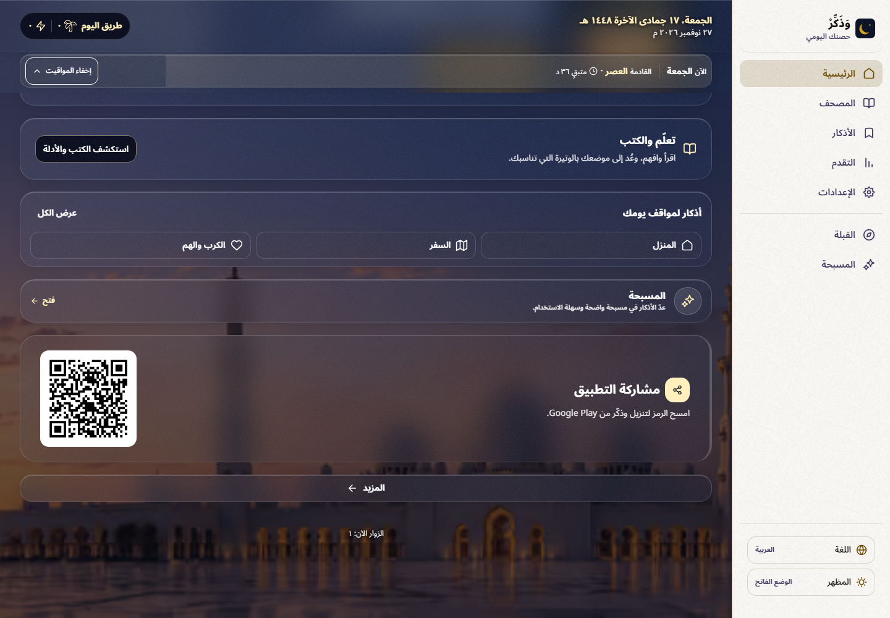
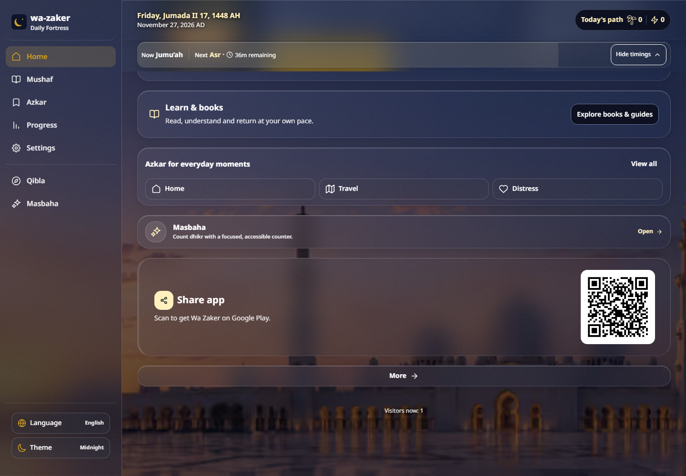
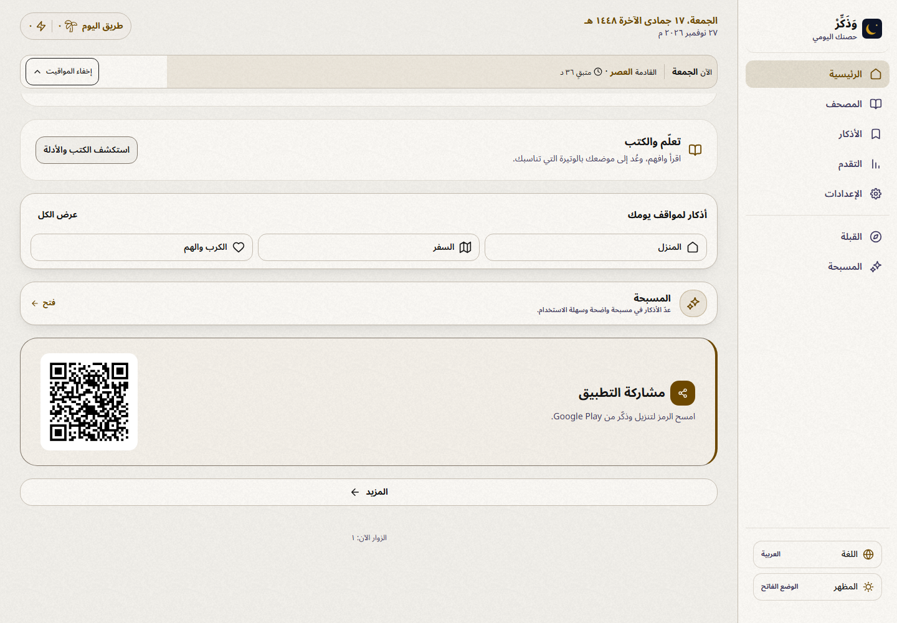
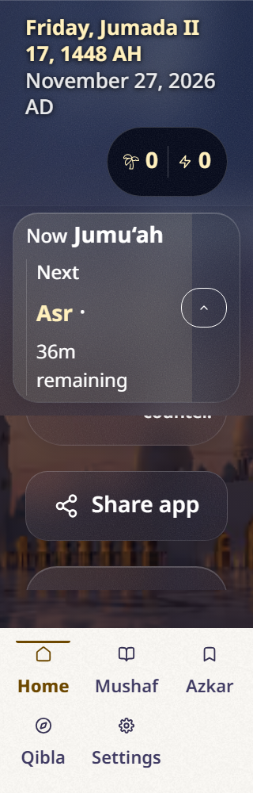

# Home material color correction — local 2026-11-27

Actual application captures after the owner's two reported color glitches. Sharing, books and More now use the same resolved Home material; nested books actions retain a matching light-ink/dark-ground pair in Glass. Exact verification and remaining aggregate limitations are in the [phase report](../../reports/HOME_MATERIAL_COLOR_LOCAL_2026_11_27_REPORT.md).

## Arabic: Light application, independently selected Home Glass

The application sidebar can remain Light while Home cards use Glass. The sharing invitation and More match the neighboring books/tools, the books action is readable, and the QR retains its white ground.

## English: Midnight and Glass

## Arabic: solid Light

Solid Light retains its own matching light surfaces and dark text instead of inheriting Glass ink.

## English: 320px/200% text, Glass Home

The compact Share action remains free of an inline QR, with normal wrapping and scrolling.

These screenshots and automated contrast/keyboard/axe checks are not physical-device or complete accessibility acceptance. Additional captures are in `output/playwright/home-material-colors/`. No commit, push or publication.
