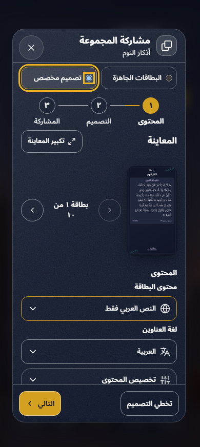
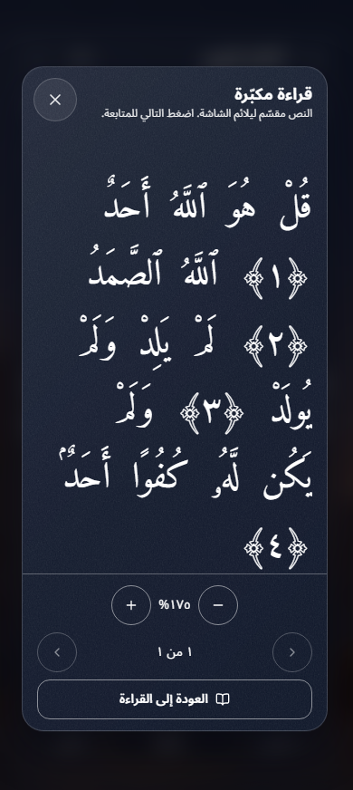

# Modal sizing evidence — local 2026-11-27

These are unedited screenshots of the actual local app in Chromium. Insets are **simulated Capacitor CSS values**: top 32px, right 12px, bottom 24px, left 8px. No Android system icons have been fabricated. They prove browser geometry, not physical Vivo/Android acceptance.

The modal work area leaves a visible gutter beyond the insets. Short enlarged excerpts derive their height from the text; editor steps retain a stable bounded area. The 320px captures use 200% text and the app's High Contrast preference. The excerpt capture at that size shows the final portion after the test verified all words in order.

| View                                             | Sharing editor                                       | Enlarged excerpt                                     |
| ------------------------------------------------ | ---------------------------------------------------- | ---------------------------------------------------- |
| Arabic phone, 390×872, Midnight Glass            | [Screenshot](sharing-ar-390-1-simulated-insets.png)  | [Screenshot](excerpt-ar-390-1-simulated-insets.png)  |
| English phone, 390×844, Light solid              | [Screenshot](sharing-en-390-1-simulated-insets.png)  | [Screenshot](excerpt-en-390-1-simulated-insets.png)  |
| Arabic narrow, 320×740, 200% text, High Contrast | [Screenshot](sharing-ar-320-2-simulated-insets.png)  | [Screenshot](excerpt-ar-320-2-simulated-insets.png)  |
| English tablet, 834×1112, Dark Glass             | [Screenshot](sharing-en-834-1-simulated-insets.png)  | [Screenshot](excerpt-en-834-1-simulated-insets.png)  |
| Arabic desktop, 1440×900, Midnight solid         | [Screenshot](sharing-ar-1440-1-simulated-insets.png) | [Screenshot](excerpt-ar-1440-1-simulated-insets.png) |
| English short landscape, 740×390, Light solid    | [Screenshot](sharing-en-740-1-simulated-insets.png)  | [Screenshot](excerpt-en-740-1-simulated-insets.png)  |

## Arabic phone

The regression tests additionally check live inset changes and recovery to zero, picker collision bounds, focus containment/return, Escape dismissal, 44px minimum hit-testable controls, no horizontal overflow, exact Quran word coverage and automated axe scans. Existing overlay motion tests cover app/OS still alternatives. Human TalkBack, physical keyboard/IME, navigation modes and cutout checks remain pending on a connected Android device.
