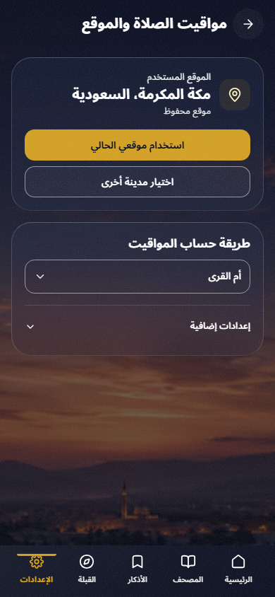
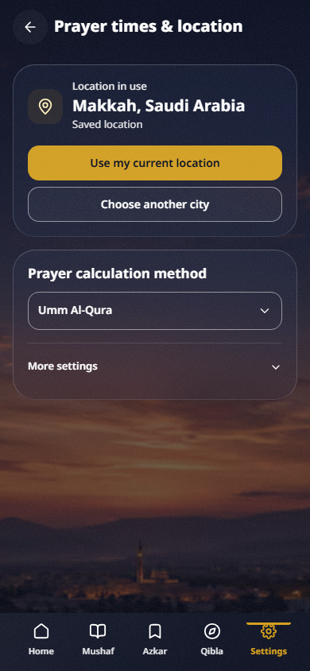
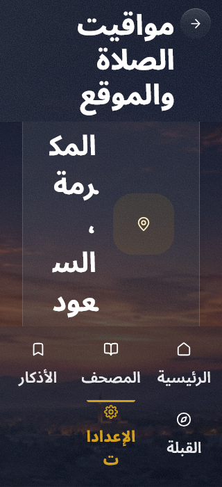
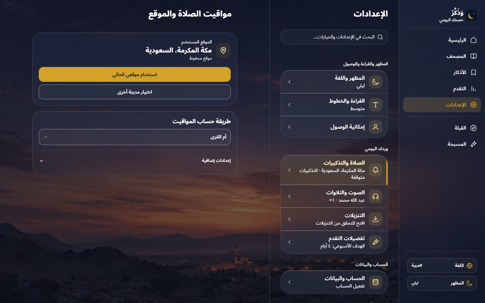
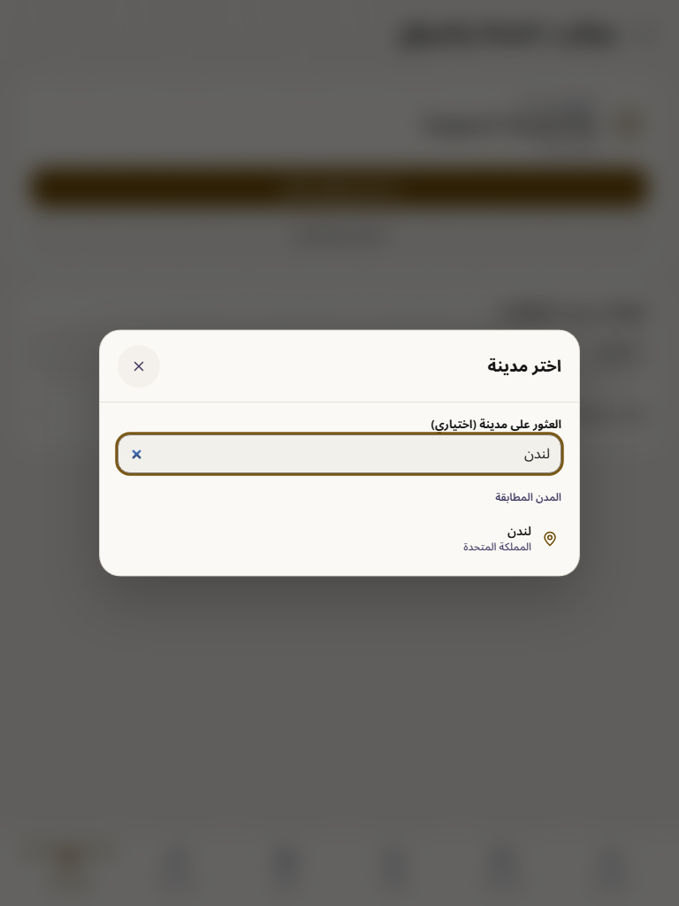
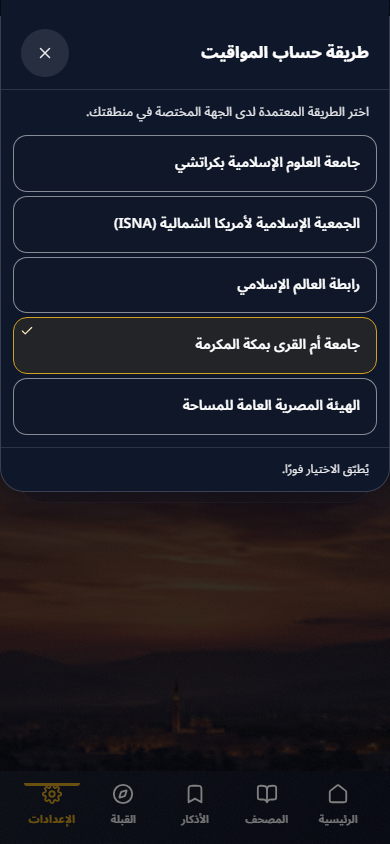
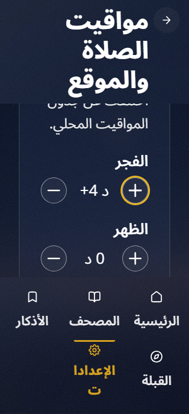
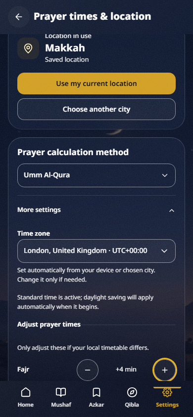

# Prayer-location simplicity — local 2026-11-27

Actual unedited local browser renders of the final selection-only page. No physical Android inset or permission acceptance is implied. Earlier manual-validation captures are superseded.

| View                                                        | Evidence                                             |
| ----------------------------------------------------------- | ---------------------------------------------------- |
| Arabic phone, 390px                                         |                         |
| English phone, 390px                                        |                        |
| Arabic Firefox, 320px/200% text                             |                   |
| Arabic desktop, 1440px                                      |                     |
| Arabic tablet city picker, 768px                            |        |
| Arabic phone calculation choices                            |                |
| Arabic 320px/200% optional adjustments, fixed 44px controls |  |
| English phone optional adjustments                          |            |

Default-page screenshots come from the 48 successful cases in `output/playwright/prayer-location-review/simple-final-browser/`. Optional corrections come from the final 12-case passing selection in `simple-corrected-browser/`; this corrected the timezone popup entrance opacity without changing the default page. Together these cover all 60 feature cases across Chromium, Firefox and WebKit. Labels, protected fill, hit testing, keyboard/focus, offline/reload durability and enlarged geometry are tested separately from screenshot review. Phone/tablet/desktop settings integration passed 15 Chromium cases.
